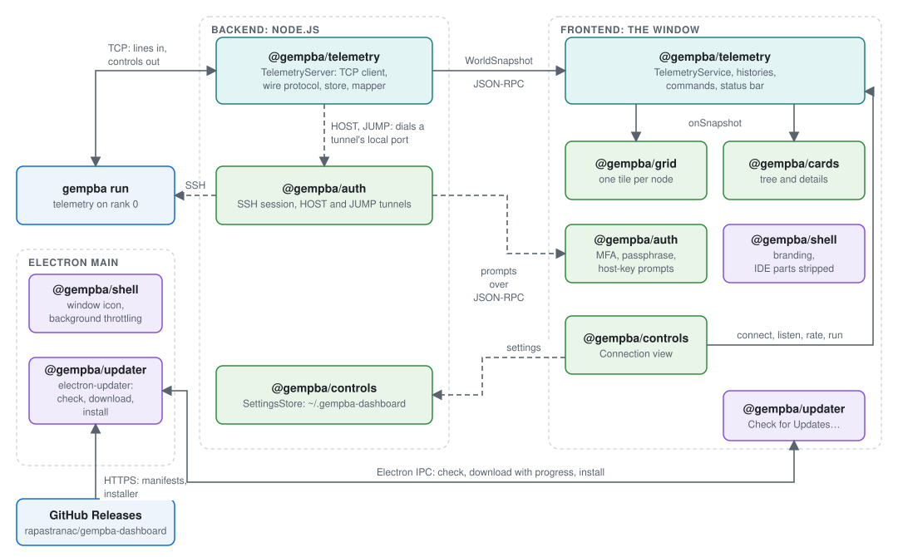
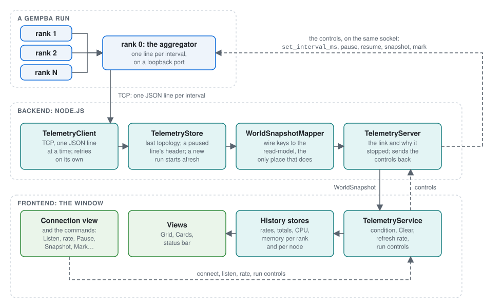
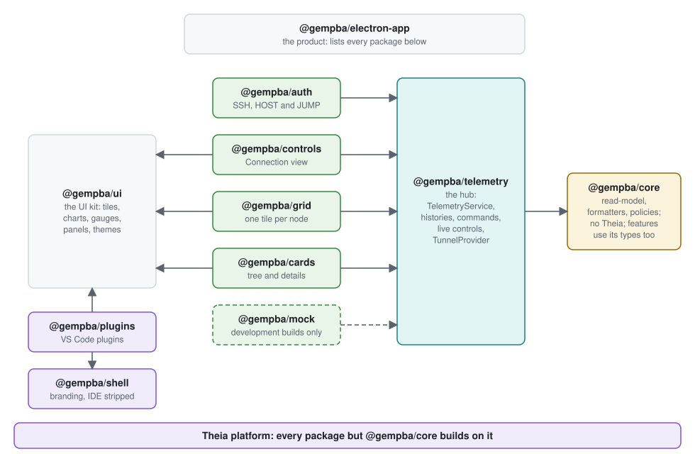
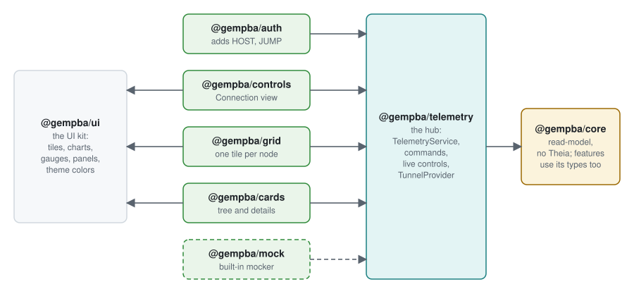
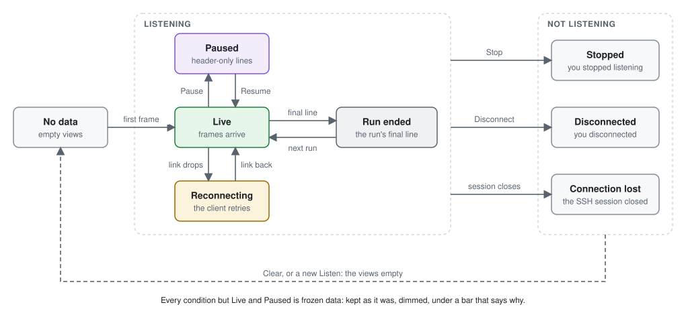
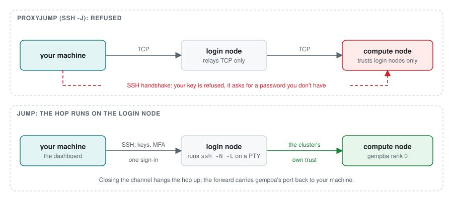

# Architecture

GemPBA Dashboard is a desktop app that shows live telemetry from the [GemPBA](https://github.com/rapastranac/gempba) parallel framework. It is built on the [Eclipse Theia](https://theia-ide.org) platform (1.76.0) and runs as an Electron app written in TypeScript.

The rule that shaped the design, carried over from the original Java/SWT version:

> The UI renders an immutable read-model; the wire format never reaches it.

In this version the rule is enforced by package boundaries and by a process boundary: the wire format is parsed in the backend process, and only the clean read-model is sent to the window.

> 2.0 is the Theia Electron app (umbrella issue #20), released together with gempba v4.3.0, whose telemetry schema 2 it reads.

**Contents**

- [Node and TypeScript in Java terms](#node-and-typescript-in-java-terms)
- [How the app runs](#how-the-app-runs)
- [Packages](#packages)
  - [Where the wire format lives](#where-the-wire-format-lives)
- [Where you can see Theia](#where-you-can-see-theia)
  - [How an extension plugs in](#how-an-extension-plugs-in)
- [How extensions connect](#how-extensions-connect)
- [Key decisions](#key-decisions)
  - [Theia and the shell](#theia-and-the-shell)
  - [The UI kit and themes](#the-ui-kit-and-themes)
  - [The views](#the-views)
  - [Telemetry: the wire and the model](#telemetry-the-wire-and-the-model)
  - [The hub and the stream](#the-hub-and-the-stream)
  - [Connections and SSH](#connections-and-ssh)
  - [Carried over from the Java app](#carried-over-from-the-java-app)
  - [The mocker](#the-mocker)
- [Build, run and test](#build-run-and-test)

---

## Node and TypeScript in Java terms

| Java world | This project |
|---|---|
| Maven, `pom.xml` | npm, `package.json` |
| Multi-module reactor | npm workspaces: every folder under `theia/` is one package |
| `~/.m2` jars | `node_modules/`, downloaded prebuilt |
| `javac` | `tsc`: TypeScript compiles to JavaScript; `tsc -b` builds the packages in dependency order (`tsconfig.json` `references`) |
| JUnit, AssertJ | mocha, chai |
| Spring, Guice (dependency injection) | inversify, Theia's DI container |
| JVM | Electron, which bundles Node.js (backend) and Chromium (the window) |

---

## How the app runs

An Electron app is three cooperating processes. Our packages each contribute to one or more of them, on top of the shared kernel and the Theia platform.

<p align="center">
  
</p>

- **Electron main** owns native windows. `@gempba/shell` sets the GemPBA icon on them here, and turns Chromium's background throttling back on once the frontend is ready, so a minimized window counts as hidden.
- **Backend** (Node.js) owns the TCP connection and, in HOST and JUMP mode, the SSH session that tunnels it. Each window gets its own `TelemetryServer`, which parses each telemetry line, maps it to a `WorldSnapshot`, and writes refresh-rate control lines back on the same socket.
- **Frontend** (Chromium) draws the UI. `TelemetryService` receives `WorldSnapshot`s from the backend over Theia's built-in JSON-RPC messaging, never raw wire frames, and hands them to the views.

A telemetry line's way from gempba's ranks to the views, and the controls' way back:

<p align="center">
  
</p>

---

## Packages

<p align="center">
  
</p>

| Package | What it holds | Java equivalent | Uses Theia? |
|---|---|---|---|
| [`@gempba/core`](theia/gempba-core) | read-model (`WorldSnapshot` → nodes → sockets → ranks, and which rank is the scheduler's coordinator), `NodeUtilization`, `CoreHeat` (the estimated load on each CPU), `TaskMoves` (the tasks started, moved between processes, and moved across nodes), `RankWork` (whether a rank runs tasks and whether it coordinates, from its own counters), formatters with `TaskWords` (what the task counters are called, and what each counts) and `RunSetupText` (how a run is set up, in one line), `ClockText` (an age, a time of day) and `StreamText` (the stream bar's words), connection config and the refresh rate (`RefreshInterval`), `StreamLink` and `StreamCondition` (what the stream's link did, and whether the data held is live, paused or frozen, and why), `NodeHistoryStore` and `RankHistoryStore` (rolling history, live rates, throughput, and every count a chart can show as a running total and a rate, with each node's sums), `FrameCadence` (how often frames actually arrive), `FrameArrivals` (when each node last sent a new frame), `SshEndpoint` | `core` | no: plain TypeScript, shared by backend and frontend |
| [`@gempba/telemetry`](theia/gempba-telemetry) | the hub. Backend: wire protocol, `TelemetryClient` (TCP), `WorldSnapshotMapper`, `TelemetryStore`, `TelemetryServer` (one per window), the `TunnelProvider` contribution point (LOCAL built in), `MockEmitter` (a stand-in for a gempba run's telemetry stream, replaying a recording, for the specs). Frontend: `TelemetryService`, `NodeHistoryService` and `RankHistoryService` (the API features inject, with when the latest frame arrived, for the stream and each node), the refresh rate setting, the live controls menu with the rate chip it puts on every `LiveTelemetryView` tab, the GemPBA commands (Clear Data and the run controls among them) with `TelemetryViewActions` (those commands as a view's buttons), and the status bar entry, worded by `StatusText` | `adapters` | yes |
| [`@gempba/shell`](theia/gempba-shell) | branding (About dialog, title-bar logo, window icon, splash, the macOS app menu), stripping the IDE features Theia brings along (commands, menus, shortcuts, views, editor and workspace settings) through the `ShellContribution` point other packages add to, never opening a workspace, and letting a minimized window count as hidden | — | yes |
| [`@gempba/plugins`](theia/gempba-plugins) | plugin support: Theia's VS Code plugin runtime and the Extensions view, to install extensions such as color themes from Open VSX, with the IDE parts the runtime brings stripped again through the shell. Removable: drop it from the app and the runtime goes with it | — | yes |
| [`@gempba/auth`](theia/gempba-auth) | a feature. Backend: `RemoteConnection` (one authenticated SSH session on `ssh2`, HOST and JUMP forwards), the HOST and JUMP `TunnelProvider`s, `KnownHosts` and `HostKeyVerifier` (trust on first use). Frontend: `AuthPromptImpl` (MFA, passphrase and host-key prompts) | `adapters` (`RemoteConnection`), `ui` (`SwtAuthPrompt`) | yes |
| [`@gempba/controls`](theia/gempba-controls) | a feature. Frontend: the Connection view (the stream's state over Session, Target, Refresh rate and Run panels, built from the UI kit), which only drives `TelemetryService`, and `RememberedRatesMove`, which moves the worker rate the view used to keep over to the hub's setting once. Backend: `SettingsStore`, the remembered settings in `~/.gempba-dashboard/settings.json` (the Java app's file), and `RememberedSettings` with the recents | `adapters` (`SettingsStore`), `ui` (`SwtSettingsView`) | yes |
| [`@gempba/ui`](theia/gempba-ui) | the UI kit, shared by the views: `Tile`, `TileGrid`, `Sparkline` (SVG, from the pure `SparklineGeometry`), `MeterBar`, the instrument-panel parts (`Panel`, `HeroStat`, `Gauge`, `HeatStrip`, `LiveIndicator`, `RateReadout`, `SegmentedControl`, `EmptyState`, `StreamBar`) with their pure logic (`GaugeGeometry`, `NiceScale`, `HeatScale`, `Liveness`, `Trend`, `RateAgreement`, `MotionTiming`), `PropertySheet` (label and value rows under section headings), `DataTable`, `VisibleRefresh` (refresh only while visible), `LivenessWatch` (recheck whether frames still arrive, only while visible), the `gempba.*` theme colors, and the GemPBA Dark and Light color themes with the theming service that keeps them current. No data, no features | `ui` (`NodeTile`'s drawing) | yes |
| [`@gempba/grid`](theia/gempba-grid) | a feature. The Grid view in the main area: the cluster at a glance. An overview on top (the stream's live indicator, nodes and ranks, the run's setup, cores busy, the cluster's tasks started with a chart, the tasks moved between processes, how idle the ranks that run tasks are, memory), then one Task Manager style tile per node (a live dot, utilization now, about two minutes of CPU history, tasks started, memory, the tasks it sent and received), built from the UI kit; `GridTiles` turns a snapshot, the histories and the frame times into the formatted overview and tiles. A click selects a tile; a double-click or Enter opens its node in whichever view handles node links. While the data isn't live a stream bar sits across the top; with no nodes it offers Listen… and Connect… | `ui` (`SwtGridView`, `NodeTile`), `GridPresenter` | yes |
| [`@gempba/cards`](theia/gempba-cards) | a feature. The Cards view in the main area, master and detail in Theia's own `SplitWidget`: on the left the Node → Socket → Rank hierarchy in Theia's own `TreeWidget` (`CardsTree` builds rows lazily), each row with a small CPU meter; on the right the picked row as a live instrument panel (`CardsPanel` builds its header, gauge, headline figures, history charts, per-CPU heat strips, bars and run totals from the snapshot and the hub's histories, each figure once; the charts follow a layout of [`ChartCatalog`](theia/gempba-cards/src/common/chart-catalog.ts) tiles, saved per panel kind by `ChartLayouts` and edited from the chart menus or by dragging); a dialog listing a rank's outgoing peers (`CardsText` words the tree and the dialog like the Java cards), and Expand Selected and Collapse All on its tab, as in Theia's explorer. A banner above both panes shows the stream bar while the data isn't live, and the empty state, with Listen… and Connect…, in their place while there are no nodes | `ui` (`SwtCardsView`, `NodeCard`, `SocketCard`, `CoresCard`, `WorkerCard`), `CardsPresenter` | yes |
| [`@gempba/mock`](theia/gempba-mock) | a feature in development builds only: the built-in mocker. Backend: `MockRun` (a seeded gempba run, stepped in simulated time), `MockAggregator` (serves it as gempba's aggregator on rank 0 does), the Local TCP and the Host and Jump SSH endpoints, and `MockService`, one mock for the whole app. Frontend: the Mock panel, the GemPBA Mock commands and a status bar entry while it runs. `npm run mock` runs the same engine without the app | the Python [gempba-dashboard-mocker](https://github.com/rapastranac/gempba-dashboard-mocker) | yes |
| [`@gempba/electron-app`](theia/electron-app) | the product: lists the Theia packages and our extensions; built and packaged | `app` | yes |

### Where the wire format lives

- The gempba wire format (snake_case JSON frames in, control lines out) is described in exactly one file: [`theia/gempba-telemetry/src/node/protocol/wire-protocol.ts`](theia/gempba-telemetry/src/node/protocol/wire-protocol.ts). It lives under `src/node`, which only the backend loads.
- [`WorldSnapshotMapper`](theia/gempba-telemetry/src/node/telemetry/world-snapshot-mapper.ts) is the only place that turns wire types into the camelCase read-model from `@gempba/core`.
- gempba documents the stream in its own `docs/telemetry/wire-format.md`, with every schema version. Dashboard 2.0 reads telemetry schema 2, which gempba v4.3.0 sends and which ships with it; gempba v4.2 and earlier, which send schema 1, are served by dashboard 1.x. The protocol reads each key by its v4.3.0 name and never gates a line by its `version`, so a line from an older gempba reads as whatever of it matches, which is close to nothing: its ranks sit under `workers`. Nothing bridges the older names. Schema 2 carries, in gempba's v4.3.0 words, a process as a rank (`ranks`, `rank`, `sentinel_rank`, `rank_local_ms`), idle time per thread (`idle_microseconds_per_thread`), `tasks_started_total`, and:
  - a `run_id` per run;
  - `paused`, and paused lines that carry only the header;
  - `final` on the line sent at shutdown;
  - each rank's `role`;
  - the run's setup (`topology.run`: scheduler, load balancer, mode, world size, threads per process, version, annotations, markers);
  - the time-accounting counters, which reach the model as a rank's `accounting` (`RunSetup` and `RankAccounting` in [`run-setup.ts`](theia/gempba-core/src/common/model/run-setup.ts)).
- The model requires what schema 2 always sends: a rank's `role` and `accounting`, and a snapshot's `runId`, `paused` and `final`. A rank whose scheduler declares no role is a worker, as gempba's wire format says. Only the run's setup stays optional, as a paused line carries the header alone.
- [`fixtures/schema2-run.ndjson`](theia/gempba-telemetry/fixtures/schema2-run.ndjson) holds lines recorded from a real gempba run (a full line, a paused line, a snapshot sent while paused), which the specs read; [`two-hosts.ndjson`](theia/gempba-telemetry/fixtures/two-hosts.ndjson) is the replay emitter's recording, two hosts and a rank with no host, in the same schema.
- Only `@gempba/core` types cross into the frontend: the JSON-RPC contract in [`telemetry-protocol.ts`](theia/gempba-telemetry/src/common/telemetry-protocol.ts) carries `WorldSnapshot`s, connection states and status text.

---

## Where you can see Theia

1. [`theia/electron-app/package.json`](theia/electron-app/package.json): its dependencies are `@theia/*` packages, it declares `"theia": { "target": "electron" }`, and its scripts call the Theia CLI (`theia build`, `theia start`). The product has no code of its own; Theia generates the startup code from this file.
2. `node_modules/@theia/`: the platform itself, downloaded prebuilt. We never compile it.
3. [`theia/gempba-shell/package.json`](theia/gempba-shell/package.json): the `"theiaExtensions"` entries tell Theia which module to load in the frontend, which in Electron main, and which only when the frontend runs in Electron (`frontendElectron`, here the macOS app menu). This is what makes a package a Theia extension.
4. [`shell-frontend-module.ts`](theia/gempba-shell/src/browser/shell-frontend-module.ts): a `ContainerModule` (think Guice module) that registers *contributions*. Theia collects every extension's contributions at startup.
5. `theia/electron-app/src-gen/` (generated by `theia build`, not committed): the startup code importing each extension's modules.
6. [`telemetry-backend-module.ts`](theia/gempba-telemetry/src/node/telemetry-backend-module.ts) and [`telemetry-frontend-module.ts`](theia/gempba-telemetry/src/browser/telemetry-frontend-module.ts): one service split across two processes. The backend registers `TelemetryServer` per window with `ConnectionContainerModule` and `bindBackendService`; the frontend gets a proxy to it from `ServiceConnectionProvider.createProxy`, and every call or notification travels as a JSON-RPC message.

### How an extension plugs in

```ts
// theia/gempba-shell/src/browser/shell-frontend-module.ts (excerpt)
export default new ContainerModule((bind, _unbind, _isBound, rebind) => {
    bind(FilterContribution).to(ShellFilterContribution).inSingletonScope();           // drop IDE-only contributions
    bind(ShellCommandStripper).toSelf().inSingletonScope();                             // one object, bound under
    bind(FrontendApplicationContribution).toService(ShellCommandStripper);              // two contribution points
    rebind(AboutDialog).to(GemPbaAboutDialog).inSingletonScope();                      // replace Theia's About dialog
    rebind(PreferenceTreeGenerator).to(UiPreferenceTreeGenerator).inSingletonScope();  // Settings: UI settings only
});
```

---

## How extensions connect

Every feature is its own Theia extension, and features plug into one hub, `@gempba/telemetry`, never into each other. Adding or removing a feature means touching that package plus one line in [`theia/electron-app/package.json`](theia/electron-app/package.json), the product's list of extensions (like a Maven `<modules>` list).

<p align="center">
  
</p>

Arrows mean "depends on"; they only point down. Extensions talk through three Theia mechanisms:

| Mechanism | Java analogy | Provided by | Used by |
|---|---|---|---|
| **Service**: an interface plus a DI token, injected with `@inject` | interface + Guice binding | telemetry: `TelemetryService`, `NodeHistoryService`, `RankHistoryService` ([`telemetry-service.ts`](theia/gempba-telemetry/src/common/telemetry-service.ts)) | controls, grid, cards |
| **Contribution point**: a socket the host loops over through a `ContributionProvider` | Eclipse extension point, `ServiceLoader` | telemetry defines `TunnelProvider` ([`tunnel-provider.ts`](theia/gempba-telemetry/src/node/tunnel/tunnel-provider.ts)), with LOCAL built in | auth fills it with HOST and JUMP |
| **Theia's shared services**: commands, selection, opening, events | listeners, an event bus, `Desktop.open` with registered handlers | Theia core: `CommandRegistry`, `SelectionService`, `OpenerService` | grid and cards publish the picked node as a `NodeSelection` ([`node-selection.ts`](theia/gempba-telemetry/src/common/node-selection.ts)) and follow each other's. Opening a Grid tile opens its node's `NodeLink` (`gempba-node:alpha`, [`node-link.ts`](theia/gempba-telemetry/src/common/node-link.ts)); cards registers the `OpenHandler` that shows it. Later views can join without importing either |

A feature's whole coupling to the stream is one injected interface:

```ts
// a view in a feature package (sketch)
@inject(TelemetryService) protected readonly telemetry: TelemetryService;

this.toDispose.push(this.telemetry.onSnapshot(snapshot => this.update(snapshot)));
```

- **Auth opens the road; telemetry drives on it.** In HOST and JUMP mode a `TunnelProvider` opens the SSH tunnel and hands telemetry a local port, which the TCP client reads exactly as in LOCAL mode. Views never learn which mode, tunnel or credentials are in use.
- **A dropped session is reported, not retried.** A `Tunnel` fires `onClose` when its session ends on its own (the server closing it, a lost network, ssh2's keepalive giving up), never after a deliberate `close()`. The telemetry server then tears the stream down, goes to DISCONNECTED and says "SSH session to … closed (…); connect again", since nothing can stream again without authenticating. A lost TCP stream over a live session, or in LOCAL mode, is still retried: there the target may come back on its own.
- **Providers live per window.** Tunnel providers are bound in a `ConnectionContainerModule`, next to that window's `TelemetryServer`, so an SSH provider prompts the window that asked: auth reaches the window's `AuthPrompt` through `bindFrontendService`, and the frontend serves it with `ServiceConnectionProvider.createHandler`. That is the reverse direction of `TelemetryService`: the backend calls the frontend and waits for the user's answer.
- **Ready for sessions.** `TelemetryService` is the *active* session's stream. Several sessions switched live can come later as a hub change plus a new feature, with no change to the views.
- **The hub owns the live controls.** The refresh rate belongs to the hub: `TelemetryService.intervalMs`, `setIntervalMs` and `onIntervalChange`, kept as the user's setting `gempba.telemetry.intervalMs` in [`rate-settings.ts`](theia/gempba-telemetry/src/browser/rate-settings.ts). Every window sends it to gempba before every Listen and Connect, and again whenever it changes, so a change in one window applies in all. The controls are one menu, `TelemetryMenus.CONTROLS` (Pause or Resume, Snapshot and Mark…; a Refresh Rate submenu with presets and Custom…; Stop Listening and Disconnect; then Clear Data), opened from the status bar entry and from a rate chip the hub draws on the tab of every view marked as a [`LiveTelemetryView`](theia/gempba-telemetry/src/browser/live-telemetry-view.ts), as the Grid and Cards are. A new control is one command and one menu item in the hub, with no change to the views, which only mark themselves.
- **One refresh rate drives every frame.** gempba 4.3 sends rank frames, node frames and its broadcast at one interval, and ignores `set_node_interval_ms`. The dashboard keeps one rate and sends it as `set_interval_ms`, the name gempba v5.0.0 keeps when it drops `set_worker_interval_ms` (rapastranac/gempba#373). The setting used to be two, `gempba.telemetry.workerIntervalMs` and `nodeIntervalMs`; at startup a saved worker rate carries over to the one rate, once, and both old keys are cleared. They stay in the schema, hidden, so a saved value can still be read.
- **The File menu is the sessions' home.** The hub puts Connect…, Listen…, Stop Listening and Disconnect in the File menu's first group, `TelemetryMenus.SESSION`. A sessions feature (a FileZilla-like site manager, several sessions at once) adds its items to that group without touching the hub's commands.
- **The rules are checked.** [`configs/check-layers.js`](configs/check-layers.js) runs first in `npm test` and fails when a package depends on a `@gempba` package outside its layer: core on nothing, telemetry on core, shell and the UI kit on nothing, plugin support on the shell and the UI kit, a feature on core, telemetry and the UI kit only. Only the app may list features.
- **Every feature must be removable.** Each feature issue checks that the app builds, boots and works with that package dropped from the app. Without controls, the stream still runs from the File menu or the command palette: File > Listen… (F1 → `GemPBA: Listen…`) streams a local gempba, File > Connect… first opens an SSH session, and the rate changes from the status bar or the palette (`GemPBA: Set Refresh Rate…`). Without auth there is no Connect, only local listening.

GemPBA's features are Theia *extensions*, composed when the app is built, not VS Code plugins loaded at runtime: plugin views are limited to webviews, and a feature plugs into the hub through dependency injection. The VS Code plugin runtime is there for the user's own add-ons, such as color themes from Open VSX (see `@gempba/plugins` below).

---

## Key decisions

### Theia and the shell

- **The smallest Theia set that boots.** `@theia/core` alone fails dependency injection: the command palette lives in `@theia/monaco`, the settings providers in `@theia/preferences`. The app uses `core`, `electron`, `monaco`, `preferences` and `messages`. What those drag in that a dashboard doesn't need is stripped by `@gempba/shell`, as the next decision explains.
- **IDE features are stripped by command, not by package.** The workspace, filesystem, editor and Monaco packages must stay, because the Settings page and Theia's core depend on them. And Theia's core contribution, which owns most File and Edit items, also does essential work (theme colors, the clipboard, the menu bar's own labels), so it can't be dropped either. So the shell removes features one command at a time:
  - **Commands:** [`ShellCommandStripper`](theia/gempba-shell/src/browser/shell-command-stripper.ts) unregisters every command in [`StrippedCommands`](theia/gempba-shell/src/browser/stripped-commands.ts) once all contributions have registered theirs, and removes their menu items. The list is grouped by reason (files, workspaces, code editors, settings JSON) and names each command by the constant Theia exports for it (`CommonCommands.SAVE`, `WorkspaceCommands.OPEN_FILE`), so a renamed or removed constant fails the build. A command's palette entry and shortcut go with it, so Ctrl+N, Ctrl+O and Ctrl+S do nothing, and on Windows Ctrl+W no longer closes the whole window.
  - **Contributions:** classes that only add IDE menus (the workspace's File and Edit items, and the editor menus, which also brought Selection and Go) are dropped whole with `FilterContribution`, matched by class, since class names are minified in production builds. The bottom panel's status-bar button goes too, as its command is stripped and no view lives there.
  - **Views:** every view is dropped unless it is on an allowlist ([`ShellViews`](theia/gempba-shell/src/common/shell-views.ts)): GemPBA's own (ids starting with `gempba-`) and the Theia views a package keeps, such as the Settings page. That drops Outline and Problems, the IDE views plugin support brings, and any a newer Theia adds.
  - **One mechanism for every package:** these lists are [`ShellContribution`](theia/gempba-shell/src/common/shell-contribution.ts)s (contributions and commands to strip, views and settings to keep). The shell registers its own lists as one, and a package that brings more of Theia, such as `@gempba/plugins`, registers its own, so removing that package removes its lists with it.
  - **Upgrades:** a listed command that is no longer registered is logged as a warning at startup (`gempba:ShellCommandStripper`), since Theia may have replaced it with one the list doesn't name. A newer Theia may also add new IDE commands, so a Theia upgrade re-checks the menus and the palette; the release smoke test checks the menus, side bar and status bar against an allowlist.
- **Plugins come back, the IDE stays out.** `@gempba/plugins` adds Theia's VS Code plugin runtime and the Extensions view, so a user can install extensions from Open VSX or a `.vsix`, color themes first. The runtime depends on about 27 more Theia packages (Terminal, Debug, SCM, Tasks, Notebooks, AI and MCP among them), so the package also strips what they bring, through the shell: their views by the allowlist, their remaining menus and commands by class ([`stripped-contributions.ts`](theia/gempba-plugins/src/browser/stripped-contributions.ts)), and AI switched off. Plugins still get the services behind those contributions, which are injected directly: a plugin may still run a task, but the dashboard offers none.
  - **Safety:** a plugin runs with the user's rights and can read anything they can, such as `~/.ssh`. The Extensions view lists only verified Open VSX publishers by default (`extensions.onlyShowVerifiedExtensions`, on the Settings page), and nothing installs without the user's click.
  - **Where plugins live:** in Theia's own folder, `~/.gempba-dashboard/theia` (`deployedPlugins/`, plus `extensions/` for `.vsix` files dropped in). Settings a plugin contributes show on the Settings page.
  - **Uninstalled themes:** Theia caches every registered color theme in IndexedDB so the active one applies before plugins load, and restores the whole cache at each start, so an uninstalled plugin's theme would stay selectable, and active if it was. Once plugins have started, [`StaleThemeCleanup`](theia/gempba-plugins/src/browser/stale-theme-cleanup.ts) drops the cached themes no installed plugin declares and nothing registered again, and resets the theme setting if it named one. It asks the UI kit's [`CacheAwareThemingService`](theia/gempba-ui/src/browser/cache-aware-theming-service.ts), a subclass of Theia's `MonacoThemingService` that keeps the registration of every theme it restores; it copies Theia's eight-line `restore()`, to recheck on Theia upgrades.
- **Settings are about the UI and GemPBA only.** The Settings page lists the settings [`UiPreferences`](theia/gempba-shell/src/common/ui-preferences.ts) allows: GemPBA's own (`gempba.*`, such as the refresh rate, in a GemPBA section right after Commonly Used), the theme, the window (title bar, menu bar, zoom), tabs, trees, the status bar and notifications. It opens on those instead of Theia's code-editor ones. The editor, file and workspace settings are left off the page but keep their values and defaults, so the code reading them is unaffected. An allowlist is used here, so settings a later Theia adds stay off the page too; settings that installed plugins contribute are shown. Settings have one scope, the user's: with no workspace open, Theia's Settings page offers only the User tab, as VS Code does with no folder open, and there is no `settings.json` editor.
- **Theia's state is the dashboard's own, and no workspace opens.** Theia keeps its state (the Settings page's `settings.json`, recent workspaces) in `~/.theia` by default, a folder every Theia app on the machine shares. There, another app's recent workspace made the dashboard reopen it on launch. The app's `configurationFolder` moves that state to `~/.gempba-dashboard/theia`, beside the Connection view's `settings.json`. And [`ShellWorkspaceService`](theia/gempba-shell/src/browser/shell-workspace-service.ts) starts every window without a workspace, since the dashboard opens no files or folders.
- **The macOS app menu is the dashboard's.** Theia builds it with Electron's own About panel. The shell's `frontendElectron` module replaces that with the GemPBA About dialog and adds Settings… (Cmd+,), where macOS apps keep it; Services, Hide and Quit stay native.
- **Stock Theia first.** The Cards view is Theia's own `SplitWidget` holding Theia's own `TreeWidget`, which draws only the rows on screen; the Cards tree builds a row's children only when it is expanded, so the collapsed parts of a large cluster cost nothing. Rows keep their ids, so expansion and selection survive every refresh, and a click picks a row without toggling it: only the chevron, a double-click or the keyboard expands one, as in VS Code's explorer. The tree is for finding a node, socket or rank; what it holds shows in the details pane beside it, so long lists of counters never crowd the tree. The pane is built from the UI kit's instruments, laid out by a pure model (`CardsPanel`, spec'd like the text), so a view decides what to show and the kit how to draw it. A rank's CPU reads as a share of the cores it may use everywhere (gauge, chart, bars, row), and only a rank with queued requests shows a queue, as only gempba's centralized coordinator reports one. A rank's title tags the coordinator by its declared role, and the aggregator on rank 0 from schema 2 on, as in "Rank 0 · coordinator · aggregator · sentinel"; a worker carries no tag, as almost every rank is one. Its panel shows what the rank does, told by its own numbers (below). Its three charts sit side by side once they fit, else one per row. As in the Java cards, the first node opens with its sentinel's socket and the sentinel rank picked. The outgoing-peers list is a stock Theia dialog. Custom visuals are used where Theia has nothing, as for the Grid's tiles.

### The UI kit and themes

- **GemPBA Dark and Light are the default themes.** The UI kit ships them as VS Code color themes ([`src/common/themes`](theia/gempba-ui/src/common/themes)), the only place a hex color appears, and registers them at startup. They are built from the logo's teal and green, and set every `gempba.*` color, the status bar (including `statusBar.noFolder*`, as no workspace ever opens), buttons, lists, menus and the `charts.*` hues. Theia draws secondary buttons with its own `secondaryButton.*` ids rather than VS Code's `button.secondary*`, so the themes set both. A spec ([`gempba-themes.spec.ts`](theia/gempba-ui/src/common/gempba-themes.spec.ts)) fails if a theme misses a `gempba.*` color, or if text falls below 4.5:1 contrast or a chart color below 3:1 against its background, so every color added later goes into both themes.
  - **Following the OS:** the app's `defaultTheme` names GemPBA Light and Dark, and Theia picks one by the OS mode at launch. Theia 1.76 doesn't follow a mode change while running (`window.autoDetectColorScheme` isn't implemented), and only turns `defaultTheme` into the theme setting's default when the frontend config has a `preferences` object, hence the empty `"preferences": {}` in [`theia/electron-app/package.json`](theia/electron-app/package.json).
  - **The cache never wins over the app:** Theia restores its theme cache after the UI kit has registered its themes, so a profile would keep the colors of the first version it cached, through every upgrade. The UI kit's [`CacheAwareThemingService`](theia/gempba-ui/src/browser/cache-aware-theming-service.ts) replaces Theia's `MonacoThemingService`: its restore skips the themes registered this session, and it applies them again if Theia reads the remembered theme from the cache after they registered.
  - **First launch:** from the second launch on, the cache applies the remembered theme before the frontend loads. The very first launch has no cache, so Theia's own theme can show for a moment.
- **Every color comes from the theme.** The views hard-code no color: the UI kit registers `gempba.*` theme colors (tiles and panels, headline figures, the CPU, memory, task, network and idle charts, gauge tracks, CPU heat, the live states), each defaulting to a standard theme color such as `charts.blue` or `editorWidget.background`, and components use them only as `var(--theia-gempba-…)`. A heat strip's shades are mixed in CSS (`color-mix`) from just two of them, the idle and the busy one, so not even a shade is a literal color. Any theme, including a VS Code theme installed as a plugin, restyles the dashboard with no code change, and can override a `gempba.*` color by id.
- **Reusable visuals live in the UI kit.** Grid, cards and the later detail views share its tiles, charts, gauges and panels, from `@gempba/ui`, which holds no data and depends on no other `@gempba` package. Charts and gauges are hand-drawn SVG; a charting library such as uPlot (MIT, no dependencies) is kept for the interactive detail charts. Their geometry and logic are pure functions in `src/common` with specs, and every component has a spec too, rendering it to markup with React's server renderer, like an HTML snapshot test in Java.
- **Motion is brief, and optional.** Only transforms, opacity and stroke offsets animate, which the browser does without laying the page out again: a meter slides by `scaleX`, a gauge sweeps by its arc's dash offset. A change takes most of a frame interval ([`MotionTiming`](theia/gempba-ui/src/common/motion-timing.ts): 80% of it, at most 400 ms, and none below 80 ms, where it would read as jitter), set as `--gempba-motion-duration`, so a value settles before the next frame moves it. Nothing animates when the OS asks for reduced motion.

### The views

- **Hidden views do no work.** Snapshots arrive several times a second. Each view refreshes through the UI kit's `VisibleRefresh`: while it is hidden (a background tab, a collapsed panel, a minimized window) a snapshot only marks it stale, and it catches up once when shown, reading the latest snapshot then. Measured in the app: the view in front updates, the one behind makes no DOM changes at all, and neither does anything while the window is minimized. A visible view redraws at most ten times a second, however fast frames arrive: a refresh sooner than 100 ms after the last waits, and the snapshots meanwhile fold into it, so it still ends on the latest one. The node and rank histories keep folding while hidden, so a graph is continuous when shown again. They hold the 120 samples a graph draws, per node and per rank, and drop the nodes and ranks that leave the run, so memory stays flat however long the app runs.
- **A minimized window is hidden, like a background tab.** Theia turns Chromium's background throttling off so that a window started minimized still finishes loading, which also keeps the page reporting itself visible when minimized. `@gempba/shell` turns it back on once the frontend reports it is ready (and off while it reloads), so the standard Page Visibility API works and `VisibleRefresh` uses it. Without the shell the app still works; a minimized window just keeps drawing.
- **Opening a node goes through Theia's opener service.** The Grid never names the view that shows a node: it opens a `NodeLink`, and Theia picks the `OpenHandler` that answers highest. Cards answers `NodeLink.VIEW_PRIORITY` (500) and brings its tab forward with the node picked and expanded; a dedicated node view could later answer higher and take over with no Grid change. The hub registers a fallback that answers 200 and opens nothing, because Theia's text editor claims every URI at 100: without it, removing Cards would leave the editor trying to open `gempba-node:alpha` as a file.
- **The Cards' charts are the user's to choose.** A rank's panel and a node's each show a row of chart tiles, three to a row, wrapping.
  - **The catalog:** [`ChartCatalog`](theia/gempba-cards/src/common/chart-catalog.ts) lists CPU, memory, idle time (ranks only) and six counts: tasks started, tasks run locally, sent and received, and bytes sent and received. A count shows as a rate, tasks per second or per minute as elsewhere and bytes per second, or as its running total, `12,200 so far`. By default a rank shows CPU, its tasks started so far and idle time, and a node CPU, its tasks started so far and memory: a rank whose work other ranks hold reads a rate of 0 for long stretches, while its total still shows its progress.
  - **Tasks run locally** are started less received, clamped at 0, as gempba confirmed for v4.3.0: the subtrees a rank handed its own pool from its own work. A live frame can read a little low, as gempba counts a received task just before submitting it. They hold on workers of gempba's built-in schedulers; a coordinator queues the tasks it receives, so its tile says it runs none locally, and a node's sum leaves coordinators out.
  - **The history:** [`RankTrack`](theia/gempba-core/src/common/history/rank-track.ts) keeps every count at each new frame and its rate over the rank's last 10 s of its own clock, and [`RankHistoryStore`](theia/gempba-core/src/common/history/rank-history-store.ts) sums them per node, so any tile can switch form without waiting for data.
  - **The layout** is a setting per panel kind, `gempba.cards.rankCharts` and `gempba.cards.nodeCharts`, a list of tile keys such as `cpu` or `tasks-started:rate`: every rank shares one, every node the other, and it survives a restart and applies in every window ([`chart-layouts.ts`](theia/gempba-cards/src/browser/chart-layouts.ts)). A key the catalog doesn't know is left out. The Charts button adds a tile or resets the layout; each chart's menu shows a count as a rate or so far, swaps it, moves it or removes it; dragging a chart onto another moves it there. The edits keep a layout free of repeats.
  - **A tile without data** on a rank says why in the chart's place, such as `No tasks run yet`, rather than drawing an empty chart, and keeps its place, so the layout stays one per kind.

### Telemetry: the wire and the model

- **The read-model is plain data.** It travels over JSON-RPC, where class methods don't survive, so each Java record became a readonly interface plus a same-named namespace for its methods (`WorldSnapshot.forHost(snapshot, host)`). `StructureKey` is a sorted array rather than a `Set`. Stateful helpers that never cross processes (`NodeHistoryStore`, `RankHistoryStore`, `TelemetryStore`) stay classes.
- **Parsing follows the Java contract.** Unknown wire fields are ignored, missing numbers read as 0, and missing objects or lists stay `undefined`. A topology node without `sockets` falls back to the live frame's socket count, while `sockets: []` means zero sockets.
- **Two topologies, two words.** Telemetry always collects at rank 0, the **aggregator**: every rank sends it its frames on telemetry's own MPI communicator, and it serves the stream, whatever the scheduler. **Coordinator** and **worker** are scheduler roles only: a coordinator hands out work and runs no tasks, a worker runs tasks, and the scheduler declares which rank is which (`role`). A run can have a coordinator on any rank or none, and rank 0 can be a worker. `WorldSnapshot.isCoordinator` follows the declared role, which titles a rank. A **rank** is a process, whatever its role, the **sentinel** is the one rank per host that sends the host's node frame, and a **thread** is one thread of a rank's pool. The read model says rank for a process too: a `RankSnapshot` holds its rank as `id`, and a socket's `ranks`, a node's `sentinelRank` and a peer's `peerRank` point at ranks. The parsed wire types take v4.3.0's names; the mocker writes its lines from its own types in [`schema2-lines.ts`](theia/gempba-mock/src/node/sim/schema2-lines.ts), which builds on the parsed types so the two can't drift.
- **Utilization is per allocation**: a node's CPU is `clamp(Σ rank CPU ÷ |allocated cores|, 0, 100)`, the user's own work on the user's own cores, excluding other tenants on a shared node.
- **Live rates are measured over a rank's own recent frames.** gempba's counters (tasks started, idle time) are totals since the rank started, so a per-second rate is the difference across a rank's frames, timed on the rank's own clock (`rank_local_ms`) rather than on when the frames reached the dashboard. Tasks are counted over the last 10 s of its frames, not between two: a rank that finishes a task every few seconds then reads a steady rate, rather than 0 with a spike whenever a frame catches one; idle time, which grows smoothly, is measured frame to frame. The frames repeat a rank's latest values until it sends new ones, so [`RankHistoryStore`](theia/gempba-core/src/common/history/rank-history-store.ts) takes a sample only from a frame with a new sequence number, and a counter that goes back, as when a rank restarts, gives no rate rather than a negative one. A node's throughput is the sum of its ranks' latest rates, and the cluster's is the sum over every node. Each series keeps 120 samples (a minute at the default 500 ms) in a `RingSeries`, a fixed `Float64Array`: like a Java `ArrayDeque` capped at a size, but allocated once.
- **gempba acknowledges no rate change, so the rate is measured.** [`FrameCadence`](theia/gempba-core/src/common/history/frame-cadence.ts) keeps the latest intervals between two new frames of one sender (a rank by its sequence number, a node by its sentinel's clock), measured on the sender's own clock, and the hub reports their medians as how often rank frames and node frames arrive. A repeated frame adds nothing, and a dropped one moves the median little. The chip and the status bar show both on hover beside the rate as set, so a rate gempba clamped or ignored shows.
- **Work a process runs is told apart from work that moves between processes.** gempba counts a subtree when a process hands it to its own threads, not when it completes, and counts the subtrees sent to and received from other processes separately, as its own end-of-run report does (`total_thread_requests`, `sent_task_count`, `received_task_count`). The views call them Tasks started, Tasks sent and Tasks received, everywhere and from one place, [`TaskWords`](theia/gempba-core/src/common/format/task-words.ts), whose tooltips name the report's field, like constants in a shared Java interface. [`TaskMoves`](theia/gempba-core/src/common/policy/task-moves.ts) adds them up for the run or a node, and tells the sends that crossed nodes from the peers each rank sent to: only those cross a network, the rest stay on their node, where processes share memory. The Grid sets the tasks moved beside the tasks started and the ranks' idle time, where waiting on other processes or on the network shows.
- **What a rank does is told by its own numbers, never by its rank number or the scheduler's name.** [`RankWork`](theia/gempba-core/src/common/policy/rank-work.ts) says a rank *runs tasks* once it has started one or spent time running or waiting for one, and *coordinates* once it has counted assignments, coordinator reports or score broadcasts, or holds queued requests. A coordinator on rank 2, a run with no coordinator, and a rank that does both all show as they are: the Cards panel has the task figures (tasks started, idle time, the pool) where a rank runs tasks and the coordination figures (the queue, assignments, reports handled) where it coordinates, so a rank doing both shows both and one that has done neither yet shows its memory and CPU; the Grid's idle average takes the ranks that run tasks.
- **A scheduler counter shows once it is non-zero.** The rows of gempba's wire format filled by a worker, a coordinator or the centralized coordinator read 0 on every rank whose scheduler doesn't fill them, and no run says which it fills, so each shows on a rank once it is non-zero there, as gempba's docs advise; a worker never shows a coordinator's counters, and a scheduler that fills none shows none. Counters every rank fills always show. In the Cards rank panel, from schema 2 on:
  - **Bytes sent** and **Bytes received**: the bytes of the tasks moved, and the time in the MPI calls that moved them, how long the rank stalled rather than the network's latency;
  - **Pool idle**: the idle time per pool thread, split into starved, while no task ran anywhere in the pool, and imbalanced, while other threads ran tasks;
  - **Waiting for work**: how long a rank waited for a task from its scheduler, a worker's counter;
  - **Assignments**: the ranks a coordinator handed work to, with the mean and longest time each took to report running, and **Reports handled**, the running and available reports it handled, a coordinator's counters.
- **How a run is set up reads as one line.** [`RunSetupText`](theia/gempba-core/src/common/format/run-setup-text.ts) turns the line's `topology.run` into `Semi-centralized · quasi-horizontal · 4 ranks · 8 threads · gempba 4.3.0`, shown in the Grid's overview with the run's annotations and markers on hover, and in the status bar's tooltip.
- **The load on each CPU is an estimate.** The frames give each rank's CPU, not each CPU's. [`CoreHeat`](theia/gempba-core/src/common/policy/core-heat.ts) spreads a rank's CPU evenly over the CPUs it may run on, or over its socket's CPUs when it is unrestricted, as core usage does, so a rank allowed on two sockets heats both. A CPU carrying more than a whole CPU of work (above 105 %, allowing for sampling noise) is flagged as oversubscribed: ranks sharing CPUs they can't all fill.

### The hub and the stream

What the views say about the data they hold, and what moves it from one condition to another:

<p align="center">
  
</p>

- **A pause keeps the views; another run starts them afresh.** While gempba is paused it sends only the line's header. [`TelemetryStore`](theia/gempba-telemetry/src/node/telemetry/telemetry-store.ts) answers such a line with the last snapshot, marked paused and `headerOnly`, rather than a world without frames, and the hub's [`TelemetryServiceImpl`](theia/gempba-telemetry/src/browser/telemetry-service-impl.ts) takes it as no new frame: no history sample, observed rate or frame time, so the charts hold still. A snapshot or the final line sent while paused carries frames and is taken as data. A line with another `run_id` is gempba restarted on the same port: the store forgets the last run's topology and snapshot, and the hub clears the histories, observed rates and frame times before the new run's first snapshot, as a new Listen does.
- **Data that stops arriving stays as it was, and says why.** Whatever the cause, the views keep what they last showed, fully usable, until Clear or a new Listen empties them; a new run on a live stream is new data, not frozen data.
  - **Why:** the backend reports what the stream's link did as a [`StreamLink`](theia/gempba-core/src/common/config/stream-link.ts) beside the connection state: up, retrying on its own, or stopped, disconnected, or the SSH session closed. The hub turns the state, the link and the latest snapshot into a [`StreamCondition`](theia/gempba-core/src/common/policy/stream-condition.ts): live, paused, ended (the final line; the hub listens for the next run), reconnecting, stopped, disconnected or lost.
  - **The bar:** Grid and Cards show [`StreamText.bar`](theia/gempba-core/src/common/format/stream-text.ts) in the UI kit's `StreamBar` across their top, such as `Not live · last frame 2 min ago (12:04:31) · stopped` with Listen again… and Clear, `Not live · … · connection lost` with Connect… and Clear (listening without a session streams this machine, so only a new session reaches the cluster again), or `Paused · last frame 12 s ago` with Resume and Snapshot, and dim frozen data a little. Its age ticks through the views' `LivenessWatch`. While the link is up and frames are only late, the stream is still live, and the liveness indicators alone say so.
  - **The status bar** words the same through [`StatusText`](theia/gempba-telemetry/src/common/status-text.ts): `2 nodes · 12.4k tasks/s · 500 ms` while live, `stopped · data from 12:04:31` while held, an icon per state.
  - **Clear** is one hub command, `TelemetryService.clear()`, offered only for frozen data: it empties the snapshot, histories, observed rates and frame times and fires `onClear`, so every view and the status bar empty together. Views never clear their own copies.
- **The run controls are the hub's.** `TelemetryService.pause()`, `resume()`, `requestSnapshot()` and `mark(label)` send gempba v4.3.0's `pause`, `resume`, `snapshot` and `mark` lines ([`RunControl`](theia/gempba-telemetry/src/common/run-control.ts)), offered while live or paused, and a marker's label from 1 to 64 bytes in UTF-8, as gempba keeps it. They are commands in the palette and the live controls menu, buttons on the bar and in the Connection view's Run panel; the status says whether each went. A mark sent while paused shows in the setup tooltip only once a Snapshot or Resume brings a full line.
- **Whether data is live is judged from the hub's frame times.** The hub notes when the latest snapshot arrived and, through [`FrameArrivals`](theia/gempba-core/src/common/history/frame-arrivals.ts), when each node's ranks last sent a frame they had not sent before, on this machine's clock, like a heartbeat timestamp. A view turns that into `Liveness`: live, paused, run ended, waiting, or off. Paused holds while gempba sends its paused lines, judged by when any line last arrived, so a pause whose stream then drops turns to waiting; run ended follows the final line until the stream stops. Since a stream that stops sends no event to redraw on, [`LivenessWatch`](theia/gempba-ui/src/browser/liveness-watch.ts) rechecks once a second while the view is visible and redraws it only when what it shows would change. The Cards header and the Grid overview show the stream's liveness; each Grid tile shows its own node's, so a stalled node fades and its dot turns to waiting while the others stay live, and shows a pause or the run's end as the stream does, without fading.

### Connections and SSH

How JUMP reaches a compute node, beside ProxyJump, which a cluster refuses (see *SSH follows the Java client and OpenSSH* below):

<p align="center">
  
</p>

- **Remembered connections are not Theia preferences.** The Connection view keeps the Java app's `~/.gempba-dashboard/settings.json` (one block per mode, recents capped at ten), served by one application-wide `SettingsServer`, so an existing user's hosts and targets come back pre-filled. The view never connects on its own. The file used to hold the refresh rates as well; the rate is the hub's setting now, and at startup [`RememberedRatesMove`](theia/gempba-controls/src/browser/remembered-rates-move.ts) moves a worker rate still changed there over to it, once, leaving the defaults in the file (which keeps both fields, as the Java app reads them). The view loads the file only after that, so it never saves an old rate back.
- **Only SSH has a session.** Connect pays the authentication (keys, MFA) once and Listen points that session at a gempba, as often as needed. A local gempba has nothing to authenticate, so Listen streams it straight away and Stop ends it, back to disconnected; Connect exists only for HOST and JUMP.
- **One telemetry session per window.** `TelemetryServer` lives in Theia's per-connection container, so each window has its own and closing the window closes its connection. That container binds a `ContributionProvider` of its own, which hides the application's, so the `TunnelProvider` contribution provider and all tunnel providers are bound inside connection modules.
- **SSH follows the Java client and OpenSSH.** One session is authenticated once (the explicit key, then the default `~/.ssh` identities, then up to three keyboard-interactive rounds for MFA) and every target is a cheap forward over it. JUMP runs `ssh -N -L` on the login node over a PTY exec channel, so the hop uses the cluster's own node-to-node trust and closing the channel hangs it up. It does not use ProxyJump (`ssh -J`): there the login node only relays TCP and this machine completes the SSH handshake with the compute node, which trusts only connections that start on a login node, so it rejects the user's key and asks for a password they don't have. gempba's own notes on this, `docs/remote-connection.md` with its `telemetry_tunnel` scripts, were removed in [rapastranac/gempba#378](https://github.com/rapastranac/gempba/issues/378) once the dashboard opened the tunnel itself, and remain in gempba's git history. Host keys are checked against the user's own `~/.ssh/known_hosts`: a known key passes, a changed key is refused without asking, and a new host is confirmed once and remembered.
- **`ssh2` stays pure JavaScript.** Its optional native install scripts (`ssh2`, `cpu-features`) are denied in `allowScripts`, so there is no extra native module to build per OS or package.
- **Connections drop stale work by epoch.** Every stop, disconnect or new target bumps an epoch; callbacks and late tunnel opens from an older epoch are discarded, as in the Java `ConnectionController`. The refresh intervals are sticky and re-sent on every (re)connect. A stream that closes after the run's final line says the run ended and waits for the next run on the same port; one that closes without it, as a crashed or killed gempba's does, reads as a lost connection and retries.

### Carried over from the Java app

- **Output matches the Java app.** `NumberText` reproduces Java's `String.format` rounding (`1.005` → `"1.01"`, where JavaScript's `toFixed` gives `"1.00"`) and groups thousands without depending on the OS locale.
- **The kernel never touches the OS.** Anything Java read implicitly (environment variables, the OS user name) is passed in: `Config.from(args, env)`, `SshEndpoint.parse(spec, defaultUser)`.
- **Existing settings keep working.** Enums are string enums (`'JUMP'`) like the existing `settings.json`, and `of()` factories fill in fields that older files lack.
- **Dead Java code was not ported**: `ConnectionSpec`, and `SshCommand`, which only served the never-used child-process tunnel. Both remain in git history.

### The mocker

- **The mocker imitates gempba as it is, in development builds only.** `@gempba/mock` stands in for gempba's telemetry so the views can be checked without a cluster, and it sends what gempba sends. Its Fidelity setting picks **gempba 4.3**, the default, as gempba v4.3.0 sends it, or **Every field**, with the socket CPU and use that gempba still leaves at zero filled in, for views that will need them. Either way it sends the topology in every line, each rank's and node's latest frame on every broadcast, a repeated frame keeping its sequence number, `process_threads` as the pool size plus one, and an interval clamped to 50…600000 ms, which paces the rank frames, the node frames and the broadcast alike.
  - **One run, consistent and repeatable:** [`MockRun`](theia/gempba-mock/src/node/sim/mock-run.ts) steps a branch-and-bound run in fixed simulated time from a seed, so the same seed and steps give the same frames. Each worker explores one received subtree at a time on its pool (tasks finish as Poisson draws) and reports itself available when it is done. The counters follow from that, as gempba's do: sent and received equal the sums over the edges, running stays within the pool, idle time and CPU follow the busy threads, and an idle worker still shows about one core, since gempba's main thread polls MPI without sleeping. Scenarios (slow tasks, a finite tree that ramps up and drains, imbalanced, bursty) and faults (a stalled node, a restarted rank, dropped clients, a rank added or removed, a malformed line, the run ending) show how the views cope. A frame of 16 nodes × 32 ranks takes a few milliseconds to build and serialize.
  - **Schema 2, as gempba 4.3 sends it:** every line carries the run's `run_id`, and the topology each rank's declared `role` and the `run` object: the scheduler, the world and pool sizes, a `mock` annotation naming the seed, and the markers. Every rank frame has every counter, 0 where its role fills nothing, as gempba's do. The time accounting (running, waiting, starved, imbalanced, telemetry) and the coordinator's counters (assignments, state messages, their latency) follow from the simulated run; their noise comes from a random stream of its own, so the run itself is the same as without them. Rank 0's telemetry time grows with the ranks it collects from, as the aggregator's does.
  - **Roles, as a scheduler declares them:** the coordinator sits on rank 0, as gempba's two schedulers put it, and the Coordinator on rank setting moves it to any rank, which then runs no tasks while rank 0 runs them. With Declare roles off the mock runs as a custom scheduler that declares nothing: no coordinator, every rank a worker, rank 0 included, ranks pairing up among themselves, and `run.scheduler` "decentralized". Rank 0 stays the aggregator either way.
  - **Controls, as gempba 4.3 answers them:** [`MockAggregator`](theia/gempba-mock/src/node/transport/mock-aggregator.ts) takes `set_interval_ms` and the older `set_worker_interval_ms` alike and ignores `set_node_interval_ms`. `pause` stops the ranks' frames while the run goes on, so lines carry the header alone, and `resume` undoes it; `snapshot` sends one full line at once, paused or not; `mark` lists a labelled moment in the run's markers, up to gempba's 32. The controls are parsed by the shared wire protocol's [`ControlLine`](theia/gempba-telemetry/src/node/protocol/wire-protocol.ts), which the dashboard's own client uses too.
  - **The run's end:** Stop and End the run send the final line, every rank's last frame marked `"final":true` even while paused, and close each client once it has it, or after a second if it doesn't read. Drop every client closes them at once, without it, as a lost connection would.
  - **gempba's schedulers, as its MPI code runs them** ([`mpi_semi_centralized_scheduler.hpp`, `mpi_centralized_scheduler.hpp`](https://github.com/rapastranac/gempba)), fixed for the run as gempba's are. Semi-centralized: the coordinator seeds the root and then only pairs each running worker with an available rank, which the worker sends one task to, with nothing else in flight; nothing ever queues, so every pending count is 0. Centralized: running workers send spare tasks to the coordinator while it isn't full (1000 tasks per process, or 10 GiB), and it hands the biggest to each available worker; its queue is the only pending count. A rank's edges reach every rank it ever sent to, so at a few hundred ranks a line runs to megabytes, as gempba's would. A further scheduler, such as a decentralized one with a queue on every rank, would be one more branch here.
  - **Like the real road:** each mode is what it stands for. Local is gempba on this machine and Host gempba on one VM, so each runs one node; Jump reaches a cluster's compute nodes behind a login node, the realistic case, so only Jump takes a node count. Local mode is a TCP port on loopback. Host and Jump are an `ssh2` server on loopback standing in for the VM or the login node: publickey (the user's keys, or a key pair it generates), an optional Duo-style passcode, and in Jump mode the dashboard's own `ssh -N -L` hop over exec, refused for an unknown compute node as ssh refuses it. It keeps its host key in `~/.gempba-dashboard/mock/` and never writes `~/.ssh`.
  - **One mock for the app:** [`MockService`](theia/gempba-mock/src/node/mock-service.ts) is application-wide, like `SettingsServer`, so every window sees the same mock and its log, and Connect this window only drives the hub's `TelemetryService`, as the Connection view does.
  - **Kept out of installers:** the app lists it under `gempbaDevExtensions`, and the production build drops those from its extensions, so no installer carries a mock or an SSH server. The release smoke test fails an installer that shows the Mock panel.
---

## Build, run and test

```
npm ci                    # install (Node 22)
npm run build             # tsc -b, then theia build
npm run rebuild:electron  # once after installing: native modules for Electron
npm start                 # launch the app
npm test                  # check the layering, lint, compile, then run every package's specs
npm run lint              # the code style alone; npx eslint --fix . repairs most of it
npm run mock              # after a build: the built-in mocker on 127.0.0.1:9000 (npm run mock -- --help)
npm run package           # installers for this OS in theia/electron-app/dist/
npm run diagrams          # redraw docs/diagrams after changing configs/diagrams.js
```

To see live data without a cluster, start the app and open the Mock panel (the beaker icon on the left), or press F1 and run `GemPBA Mock: Start…`. Pick how the dashboard reaches the mock and what the run does, press Start, then Connect this window. The Grid tab shows the cluster's overview and one tile per node (double-click one to open it in Cards; the Stall a node fault fades its tile), the Cards tab the node, socket and rank tree with the picked row's details, and the status bar the node count. The panel also changes the run live, injects faults, and lists what to type into the Connection view to reach the mock by hand. Without the app's mocker, as for an installed app, `npm run mock` serves the same run: in the Connection view pick Local and press Listen (port 9000).

- Specs live next to their sources (`*.spec.ts`) and run from the compiled `lib/`. The root [`.mocharc.js`](.mocharc.js) lets an IDE run or debug a single spec file: it builds the package and runs the compiled copy, so breakpoints map back to the TypeScript through source maps.
- Native modules exist in two builds: `npm rebuild` targets Node.js (tests), `npm run rebuild:electron` targets Electron (the app).
- The app keeps its state in `~/.gempba-dashboard`: `settings.json` for the Connection view, and `theia/` for Theia's own (the Settings page's `settings.json`), set by `configurationFolder` in [`theia/electron-app/package.json`](theia/electron-app/package.json). The mocker keeps its SSH keys and the configuration last started in `mock/`.
- npm only runs the install scripts listed under `allowScripts` in the root `package.json`.
- On Windows, building from source needs Visual Studio's C++ tools with the **MSVC Spectre-mitigated libs (Latest)** component: the plugin runtime's `@vscode/windows-ca-certs` compiles natively and requires it, and npm silently skips that optional package if the compile fails, which then fails the app build.
- Code style: [`eslint.config.mjs`](eslint.config.mjs) holds the rules, after Theia's own (single quotes, semicolons, braces on every block, lines up to 180), and [`.editorconfig`](.editorconfig) the indentation and line endings. `npm test`, and so CI, fails on any violation. WebStorm needs no setup: it reads the `ij_` keys in `.editorconfig`, so its Reformat Code produces this style, and it shows ESLint's findings in the editor. Nothing under `.idea` is committed.
- CI ([`.github/workflows/ci.yml`](.github/workflows/ci.yml)) installs, compiles, tests and builds on Linux, Windows and macOS, through the shared [`setup-node-theia`](.github/actions/setup-node-theia/action.yml) action. Runners come from the `RUNNER_LINUX`, `RUNNER_WINDOWS`, `RUNNER_MACOS_ARM` and `RUNNER_MACOS_INTEL` variables, each a JSON array of runner labels read with `fromJSON` as gempba's workflows read them, so the same self-hosted runners serve both repositories; GitHub's hosted runners are the defaults. CI's macOS job runs on the Intel runner, so a pull request needs only self-hosted runners: the app's TypeScript doesn't depend on the CPU, and what can break only on Apple Silicon (native modules, downloaded binaries, arm64 packaging) is built and booted by the release workflow before anything ships.
- Installers: [`electron-builder.yml`](theia/electron-app/electron-builder.yml), after the Theia IDE's. `npm run package` rebuilds the native modules for Electron, builds the production bundle and packages it: an NSIS installer on Windows, a dmg and zip on macOS, an AppImage and deb on Linux. Only the bundled `lib/` and `src-gen/` ship, without `node_modules` or source maps, which also keeps the replay emitter's fixtures out. The production bundle leaves out the extensions the app lists under `gempbaDevExtensions`, the mocker among them: [`configs/build-production.js`](configs/build-production.js) drops them from the dependencies Theia collects extensions from, in memory, before building. Each OS packages on its own runner, because native modules are compiled against Electron's ABI per OS and architecture; macOS arm64 and x64 are separate builds. The icon is [`branding/favicon.svg`](branding/favicon.svg) rendered at 1024 px by [`branding/render-icon.js`](branding/render-icon.js). The installers are unsigned: Windows shows "Unknown publisher", and macOS asks the user to allow the app once.
- Releasing: run the Prepare release workflow ([`prepare-release.yml`](.github/workflows/prepare-release.yml)) with the version. It sets every package to it ([`configs/set-version.js`](configs/set-version.js)), drafts the release notes in `docs/releases/` and opens a PR to `main`. After curating the notes and merging, push the `vX.Y.Z` tag: [`release.yml`](.github/workflows/release.yml) packages on Linux, Windows, macOS arm64 and macOS x64, boots each packaged app ([`configs/smoke-test.js`](configs/smoke-test.js) fails on any frontend error, on a menu, side-bar view or status-bar item outside the dashboard's, or unless the fixture theme plugin in [`configs/fixtures/plugins`](configs/fixtures/plugins) loads) and attaches the installers to the GitHub Release. A manual run, or a PR that changes the packaging, does the same without publishing.
