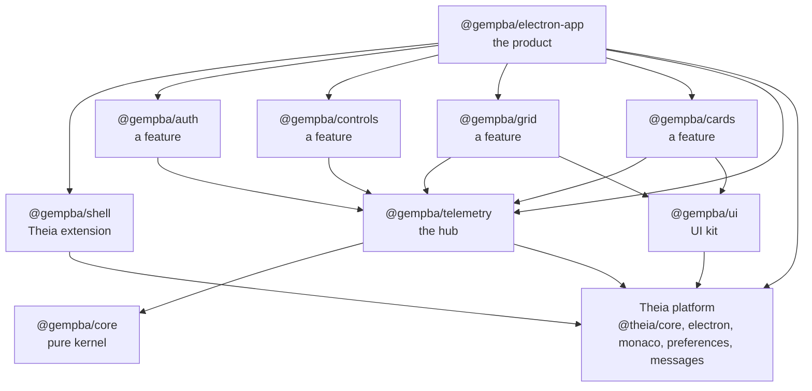
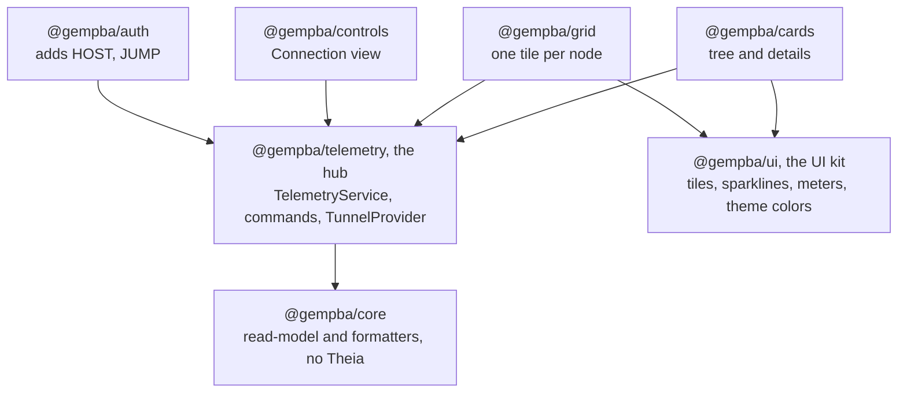

# Architecture

GemPBA Dashboard is a desktop app that shows live telemetry from the [GemPBA](https://github.com/rapastranac/gempba) parallel framework. It is built on the [Eclipse Theia](https://theia-ide.org) platform (1.76.0) and runs as an Electron app written in TypeScript.

The rule that shaped the design, carried over from the original Java/SWT version:

> The UI renders an immutable read-model; the wire format never reaches it.

In this version the rule is enforced by package boundaries and by a process boundary: the wire format is parsed in the backend process, and only the clean read-model is sent to the window.

> This document grows with the migration (umbrella issue #20). Sections marked *coming* describe planned work.

---

## Node and TypeScript in Java terms

| Java world | This project |
|---|---|
| Maven, `pom.xml` | npm, `package.json` |
| Multi-module reactor | npm workspaces: every folder under `theia/` is one package |
| `~/.m2` jars | `node_modules/`, downloaded prebuilt |
| `javac` | `tsc`: TypeScript compiles to JavaScript; `tsc -b` builds the packages in dependency order (`tsconfig.json` `references`) |
| JUnit, AssertJ | mocha, chai |
| Spring, Guice (dependency injection) | inversify, Theia's DI container |
| JVM | Electron, which bundles Node.js (backend) and Chromium (the window) |

---

## How the app runs

An Electron app is three cooperating processes. Our packages each contribute to one or more of them, on top of the shared kernel and the Theia platform.


- **Electron main** owns native windows. `@gempba/shell` sets the GemPBA icon on them here, and turns Chromium's background throttling back on once the frontend is ready, so a minimized window counts as hidden.
- **Backend** (Node.js) owns the TCP connection and, in HOST and JUMP mode, the SSH session that tunnels it. Each window gets its own `TelemetryServer`, which parses each telemetry line, maps it to a `WorldSnapshot`, and writes refresh-rate control lines back on the same socket.
- **Frontend** (Chromium) draws the UI. `TelemetryService` receives `WorldSnapshot`s from the backend over Theia's built-in JSON-RPC messaging, never raw wire frames, and hands them to the views.

---

## Packages



| Package | What it holds | Java equivalent | Uses Theia? |
|---|---|---|---|
| [`@gempba/core`](theia/gempba-core) | read-model (`WorldSnapshot` → nodes → sockets → workers), `NodeUtilization`, formatters, connection config, `NodeHistoryStore`, `SshEndpoint` | `core` | no: plain TypeScript, shared by backend and frontend |
| [`@gempba/telemetry`](theia/gempba-telemetry) | the hub. Backend: wire protocol, `TelemetryClient` (TCP), `WorldSnapshotMapper`, `TelemetryStore`, `TelemetryServer` (one per window), the `TunnelProvider` contribution point (LOCAL built in), `MockEmitter` (a stand-in gempba center). Frontend: `TelemetryService` and `NodeHistoryService` (the API features inject), the GemPBA commands and status bar entry | `adapters` | yes |
| [`@gempba/shell`](theia/gempba-shell) | branding (About dialog, title-bar logo, window icon, splash), hiding the IDE parts Theia brings along, and letting a minimized window count as hidden | — | yes |
| [`@gempba/auth`](theia/gempba-auth) | a feature. Backend: `RemoteConnection` (one authenticated SSH session on `ssh2`, HOST and JUMP forwards), the HOST and JUMP `TunnelProvider`s, `KnownHosts` and `HostKeyVerifier` (trust on first use). Frontend: `AuthPromptImpl` (MFA, passphrase and host-key prompts) | `adapters` (`RemoteConnection`), `ui` (`SwtAuthPrompt`) | yes |
| [`@gempba/controls`](theia/gempba-controls) | a feature. Frontend: the Connection view (session, target, refresh rates), which only drives `TelemetryService`. Backend: `SettingsStore`, the remembered settings in `~/.gempba-dashboard/settings.json` (the Java app's file), and `RememberedSettings` with the recents | `adapters` (`SettingsStore`), `ui` (`SwtSettingsView`) | yes |
| [`@gempba/ui`](theia/gempba-ui) | the UI kit, shared by the views: `Tile`, `TileGrid`, `Sparkline` (SVG, from the pure `SparklineGeometry`), `MeterBar`, `PropertySheet` (label and value rows under section headings), `DataTable`, `VisibleRefresh` (refresh only while visible), and the `gempba.*` theme colors. No data, no features | `ui` (`NodeTile`'s drawing) | yes |
| [`@gempba/grid`](theia/gempba-grid) | a feature. The Grid view in the main area: one Task Manager style tile per node (utilization now, about two minutes of CPU history, memory), built from the UI kit; `GridTiles` turns a snapshot and its history into formatted tiles. A click selects a tile; a double-click or Enter opens its node in whichever view handles node links | `ui` (`SwtGridView`, `NodeTile`), `GridPresenter` | yes |
| [`@gempba/cards`](theia/gempba-cards) | a feature. The Cards view in the main area, master and detail in Theia's own `SplitWidget`: on the left the Node → Socket → Worker hierarchy in Theia's own `TreeWidget` (`CardsTree` builds rows lazily), on the right the picked row's details (`CardsText` words them like the Java cards: a worker's counters, a socket's core usage), and a dialog listing a worker's outgoing peers | `ui` (`SwtCardsView`, `NodeCard`, `SocketCard`, `CoresCard`, `WorkerCard`), `CardsPresenter` | yes |
| [`@gempba/electron-app`](theia/electron-app) | the product: lists the Theia packages and our extensions; built and packaged | `app` | yes |

### Where the wire format lives

- The gempba wire format (snake_case JSON frames in, control lines out) is described in exactly one file: [`theia/gempba-telemetry/src/node/protocol/wire-protocol.ts`](theia/gempba-telemetry/src/node/protocol/wire-protocol.ts). It lives under `src/node`, which only the backend loads.
- [`WorldSnapshotMapper`](theia/gempba-telemetry/src/node/telemetry/world-snapshot-mapper.ts) is the only place that turns wire types into the camelCase read-model from `@gempba/core`.
- Only `@gempba/core` types cross into the frontend: the JSON-RPC contract in [`telemetry-protocol.ts`](theia/gempba-telemetry/src/common/telemetry-protocol.ts) carries `WorldSnapshot`s, connection states and status text.

---

## Where you can see Theia

1. [`theia/electron-app/package.json`](theia/electron-app/package.json): its dependencies are `@theia/*` packages, it declares `"theia": { "target": "electron" }`, and its scripts call the Theia CLI (`theia build`, `theia start`). The product has no code of its own; Theia generates the startup code from this file.
2. `node_modules/@theia/`: the platform itself, downloaded prebuilt. We never compile it.
3. [`theia/gempba-shell/package.json`](theia/gempba-shell/package.json): the `"theiaExtensions"` entry tells Theia which module to load in the frontend and which in Electron main. This is what makes a package a Theia extension.
4. [`shell-frontend-module.ts`](theia/gempba-shell/src/browser/shell-frontend-module.ts): a `ContainerModule` (think Guice module) that registers *contributions*. Theia collects every extension's contributions at startup.
5. `theia/electron-app/src-gen/` (generated by `theia build`, not committed): the startup code importing each extension's modules.
6. [`telemetry-backend-module.ts`](theia/gempba-telemetry/src/node/telemetry-backend-module.ts) and [`telemetry-frontend-module.ts`](theia/gempba-telemetry/src/browser/telemetry-frontend-module.ts): one service split across two processes. The backend registers `TelemetryServer` per window with `ConnectionContainerModule` and `bindBackendService`; the frontend gets a proxy to it from `ServiceConnectionProvider.createProxy`, and every call or notification travels as a JSON-RPC message.

### How an extension plugs in

```ts
// theia/gempba-shell/src/browser/shell-frontend-module.ts (excerpt)
export default new ContainerModule((bind, _unbind, _isBound, rebind) => {
    bind(FilterContribution).to(ShellFilterContribution).inSingletonScope();  // hide Outline and Problems
    bind(MenuContribution).to(ShellMenuContribution).inSingletonScope();      // remove Selection and Go menus
    rebind(AboutDialog).to(GemPbaAboutDialog).inSingletonScope();             // replace Theia's About dialog
});
```

---

## How extensions connect

Every feature is its own Theia extension, and features plug into one hub, `@gempba/telemetry`, never into each other. Adding or removing a feature means touching that package plus one line in [`theia/electron-app/package.json`](theia/electron-app/package.json), the product's list of extensions (like a Maven `<modules>` list).



Arrows mean "depends on"; they only point down. Extensions talk through three Theia mechanisms:

| Mechanism | Java analogy | Provided by | Used by |
|---|---|---|---|
| **Service**: an interface plus a DI token, injected with `@inject` | interface + Guice binding | telemetry: `TelemetryService`, `NodeHistoryService` ([`telemetry-service.ts`](theia/gempba-telemetry/src/common/telemetry-service.ts)) | controls, grid, cards |
| **Contribution point**: a socket the host loops over through a `ContributionProvider` | Eclipse extension point, `ServiceLoader` | telemetry defines `TunnelProvider` ([`tunnel-provider.ts`](theia/gempba-telemetry/src/node/tunnel/tunnel-provider.ts)), with LOCAL built in | auth fills it with HOST and JUMP |
| **Theia's shared services**: commands, selection, opening, events | listeners, an event bus, `Desktop.open` with registered handlers | Theia core: `CommandRegistry`, `SelectionService`, `OpenerService` | grid and cards publish the picked node as a `NodeSelection` ([`node-selection.ts`](theia/gempba-telemetry/src/common/node-selection.ts)) and follow each other's. Opening a Grid tile opens its node's `NodeLink` (`gempba-node:alpha`, [`node-link.ts`](theia/gempba-telemetry/src/common/node-link.ts)); cards registers the `OpenHandler` that shows it. Later views can join without importing either |

A feature's whole coupling to the stream is one injected interface:

```ts
// a view in a feature package (sketch)
@inject(TelemetryService) protected readonly telemetry: TelemetryService;

this.toDispose.push(this.telemetry.onSnapshot(snapshot => this.update(snapshot)));
```

- **Auth opens the road; telemetry drives on it.** In HOST and JUMP mode a `TunnelProvider` opens the SSH tunnel and hands telemetry a local port, which the TCP client reads exactly as in LOCAL mode. Views never learn which mode, tunnel or credentials are in use.
- **Providers live per window.** Tunnel providers are bound in a `ConnectionContainerModule`, next to that window's `TelemetryServer`, so an SSH provider prompts the window that asked: auth reaches the window's `AuthPrompt` through `bindFrontendService`, and the frontend serves it with `ServiceConnectionProvider.createHandler`. That is the reverse direction of `TelemetryService`: the backend calls the frontend and waits for the user's answer.
- **Ready for sessions.** `TelemetryService` is the *active* session's stream. Several sessions switched live can come later as a hub change plus a new feature, with no change to the views.
- **The rules are checked.** [`configs/check-layers.js`](configs/check-layers.js) runs first in `npm test` and fails when a package depends on a `@gempba` package outside its layer: core on nothing, telemetry on core, shell and the UI kit on nothing, a feature on core, telemetry and the UI kit only. Only the app may list features.
- **Every feature must be removable.** Each feature issue checks that the app builds, boots and works with that package dropped from the app. Without controls, the stream still runs from the command palette: F1 → `GemPBA: Listen…` streams a local gempba, and `GemPBA: Connect…` first opens an SSH session. Without auth there is no Connect, only local listening.

These are Theia *extensions*, composed when the app is built, not VS Code plugins loaded at runtime: the plugin runtime would bring back about 30 IDE packages, and plugin views are limited to webviews.

---

## Key decisions

- **The smallest Theia set that boots.** `@theia/core` alone fails dependency injection: the command palette lives in `@theia/monaco`, the settings providers in `@theia/preferences`. The app uses `core`, `electron`, `monaco`, `preferences` and `messages`. What those drag in that a dashboard doesn't need is hidden by `@gempba/shell` with `FilterContribution` (matched by class, since class names are minified in production builds) and menu unregistration.
- **The read-model is plain data.** It travels over JSON-RPC, where class methods don't survive, so each Java record became a readonly interface plus a same-named namespace for its methods (`WorldSnapshot.forHost(snapshot, host)`). `StructureKey` is a sorted array rather than a `Set`. Stateful helpers that never cross processes (`NodeHistoryStore`, `TelemetryStore`) stay classes.
- **Output matches the Java app.** `NumberText` reproduces Java's `String.format` rounding (`1.005` → `"1.01"`, where JavaScript's `toFixed` gives `"1.00"`) and groups thousands without depending on the OS locale.
- **The kernel never touches the OS.** Anything Java read implicitly (environment variables, the OS user name) is passed in: `Config.from(args, env)`, `SshEndpoint.parse(spec, defaultUser)`.
- **Existing settings keep working.** Enums are string enums (`'JUMP'`) like the existing `settings.json`, and `of()` factories fill in fields that older files lack.
- **Every color comes from the theme.** The views hard-code no color: the UI kit registers `gempba.*` theme colors (tile background and borders, CPU and memory charts, grid lines), each defaulting to a standard theme color such as `charts.blue` or `editorWidget.background`, and components use them only as `var(--theia-gempba-…)`. Any theme, including a VS Code theme installed as a plugin, restyles the dashboard with no code change, and can override a `gempba.*` color by id.
- **Hidden views do no work.** Snapshots arrive several times a second. Each view refreshes through the UI kit's `VisibleRefresh`: while it is hidden (a background tab, a collapsed panel, a minimized window) a snapshot only marks it stale, and it catches up once when shown, reading the latest snapshot then. Measured in the app: the view in front updates, the one behind makes no DOM changes at all, and neither does anything while the window is minimized. The node history keeps folding while hidden, so a graph is continuous when shown again. It holds the 120 samples a graph draws per node, so memory stays flat however long the app runs.
- **A minimized window is hidden, like a background tab.** Theia turns Chromium's background throttling off so that a window started minimized still finishes loading, which also keeps the page reporting itself visible when minimized. `@gempba/shell` turns it back on once the frontend reports it is ready (and off while it reloads), so the standard Page Visibility API works and `VisibleRefresh` uses it. Without the shell the app still works; a minimized window just keeps drawing.
- **Opening a node goes through Theia's opener service.** The Grid never names the view that shows a node: it opens a `NodeLink`, and Theia picks the `OpenHandler` that answers highest. Cards answers `NodeLink.VIEW_PRIORITY` (500) and brings its tab forward with the node picked and expanded; a dedicated node view could later answer higher and take over with no Grid change. The hub registers a fallback that answers 200 and opens nothing, because Theia's text editor claims every URI at 100: without it, removing Cards would leave the editor trying to open `gempba-node:alpha` as a file.
- **Stock Theia first.** The Cards view is Theia's own `SplitWidget` holding Theia's own `TreeWidget`, which draws only the rows on screen; the Cards tree builds a row's children only when it is expanded, so the collapsed parts of a large cluster cost nothing. Rows keep their ids, so expansion and selection survive every refresh. The tree is for finding a node, socket or worker; what it holds shows in the details pane beside it, so long lists of counters never crowd the tree. As in the Java cards, the first node opens with its sentinel's socket and the sentinel worker picked. The outgoing-peers list is a stock Theia dialog. Custom visuals are used where Theia has nothing, as for the Grid's tiles.
- **Reusable visuals live in the UI kit.** Grid, cards and the later detail views share `Tile`, `Sparkline` and `MeterBar` from `@gempba/ui`, which holds no data and depends on no other `@gempba` package. Sparklines are hand-drawn SVG (about a hundred lines with their geometry); a charting library such as uPlot (MIT, no dependencies) is kept for the interactive detail charts.
- **Remembered settings are not Theia preferences.** The Connection view keeps the Java app's `~/.gempba-dashboard/settings.json` (one block per mode, recents capped at ten), served by one application-wide `SettingsServer`, so an existing user's hosts and targets come back pre-filled. The view never connects on its own.
- **Parsing follows the Java contract.** Unknown wire fields are ignored, missing numbers read as 0, and missing objects or lists stay `undefined`. A topology node without `sockets` falls back to the live frame's socket count, while `sockets: []` means zero sockets.
- **Utilization is per allocation**: a node's CPU is `clamp(Σ worker CPU ÷ |allocated cores|, 0, 100)`, the user's own work on the user's own cores, excluding other tenants on a shared node.
- **Only SSH has a session.** Connect pays the authentication (keys, MFA) once and Listen points that session at a gempba, as often as needed. A local gempba has nothing to authenticate, so Listen streams it straight away and Stop ends it, back to disconnected; Connect exists only for HOST and JUMP.
- **One telemetry session per window.** `TelemetryServer` lives in Theia's per-connection container, so each window has its own and closing the window closes its connection. That container binds a `ContributionProvider` of its own, which hides the application's, so the `TunnelProvider` contribution provider and all tunnel providers are bound inside connection modules.
- **SSH follows the Java client and OpenSSH.** One session is authenticated once (the explicit key, then the default `~/.ssh` identities, then up to three keyboard-interactive rounds for MFA) and every target is a cheap forward over it. JUMP runs `ssh -N -L` on the login node over a PTY exec channel, so the hop uses the cluster's own node-to-node trust and closing the channel hangs it up. Host keys are checked against the user's own `~/.ssh/known_hosts`: a known key passes, a changed key is refused without asking, and a new host is confirmed once and remembered.
- **`ssh2` stays pure JavaScript.** Its optional native install scripts (`ssh2`, `cpu-features`) are denied in `allowScripts`, so there is no extra native module to build per OS or package.
- **Connections drop stale work by epoch.** Every stop, disconnect or new target bumps an epoch; callbacks and late tunnel opens from an older epoch are discarded, as in the Java `ConnectionController`. The refresh intervals are sticky and re-sent on every (re)connect.
- **Dead Java code was not ported**: `ConnectionSpec`, and `SshCommand`, which only served the never-used child-process tunnel. Both remain in git history.

---

## Build, run and test

```
npm ci                    # install (Node 22)
npm run build             # tsc -b, then theia build
npm run rebuild:electron  # once after installing: native modules for Electron
npm start                 # launch the app
npm test                  # check the layering, compile, then run every package's specs
npm run mock              # after a build: a stand-in gempba center on 127.0.0.1:9000
```

To see live data without a cluster: run `npm run mock`, start the app, then in the Connection view (the plug icon on the left) pick Local and press Listen (port 9000); the palette's `GemPBA: Listen…` does the same. The Grid tab shows one tile per node (double-click one to open it in Cards), the Cards tab the node, socket and worker tree with the picked row's details, and the status bar the node count. For HOST and JUMP, the Python [gempba-dashboard-mocker](https://github.com/apdistributedsystems/gempba-dashboard-mocker) impersonates a VM or a login node with MFA.

- Specs live next to their sources (`*.spec.ts`) and run from the compiled `lib/`. The root [`.mocharc.js`](.mocharc.js) lets an IDE run or debug a single spec file: it builds the package and runs the compiled copy, so breakpoints map back to the TypeScript through source maps.
- Native modules exist in two builds: `npm rebuild` targets Node.js (tests), `npm run rebuild:electron` targets Electron (the app).
- npm only runs the install scripts listed under `allowScripts` in the root `package.json`.
- CI ([`.github/workflows/ci.yml`](.github/workflows/ci.yml)) installs, compiles, tests and builds on Linux, Windows and macOS. Installers and releases come with #30.
