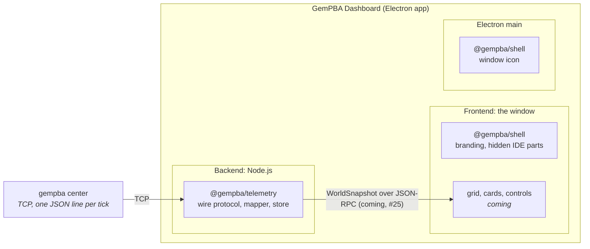
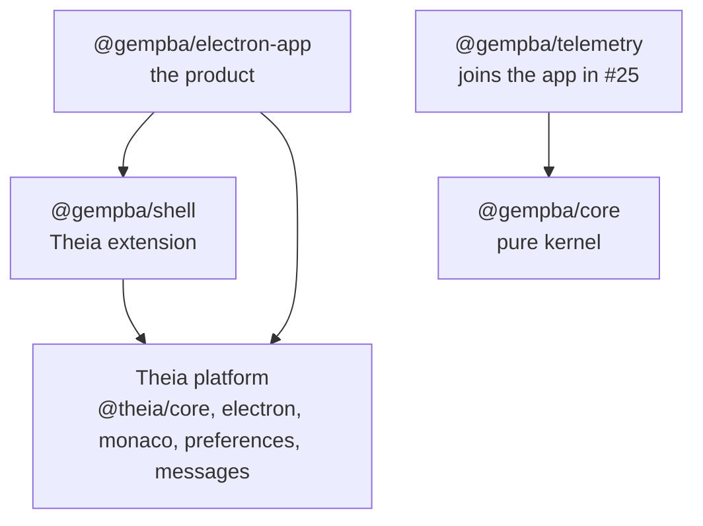

# Architecture

GemPBA Dashboard is a desktop app that shows live telemetry from the [GemPBA](https://github.com/rapastranac/gempba) parallel framework. It is built on the [Eclipse Theia](https://theia-ide.org) platform (1.76.0) and runs as an Electron app written in TypeScript.

The rule that shaped the design, carried over from the original Java/SWT version:

> The UI renders an immutable read-model; the wire format never reaches it.

In this version the rule is enforced by package boundaries and, once the backend service lands (#25), by a process boundary: the wire format is parsed in the backend process, and only the clean read-model is sent to the window.

> This document grows with the migration (umbrella issue #20). Sections marked *coming* describe planned work.

---

## Node and TypeScript in Java terms

| Java world | This project |
|---|---|
| Maven, `pom.xml` | npm, `package.json` |
| Multi-module reactor | npm workspaces: every folder under `theia/` is one package |
| `~/.m2` jars | `node_modules/`, downloaded prebuilt |
| `javac` | `tsc`: TypeScript compiles to JavaScript; `tsc -b` builds the packages in dependency order (`tsconfig.json` `references`) |
| JUnit, AssertJ | mocha, chai |
| Spring, Guice (dependency injection) | inversify, Theia's DI container |
| JVM | Electron, which bundles Node.js (backend) and Chromium (the window) |

---

## How the app runs

An Electron app is three cooperating processes. Our packages each contribute to one or more of them, on top of the shared kernel and the Theia platform.



- **Electron main** owns native windows. `@gempba/shell` sets the GemPBA icon on them here.
- **Backend** (Node.js) will own the TCP connection and the SSH tunnel. It parses each telemetry line and maps it to a `WorldSnapshot`.
- **Frontend** (Chromium) draws the UI. It receives `WorldSnapshot`s from the backend over Theia's built-in JSON-RPC messaging, never raw wire frames.

---

## Packages



| Package | What it holds | Java equivalent | Uses Theia? |
|---|---|---|---|
| [`@gempba/core`](theia/gempba-core) | read-model (`WorldSnapshot` → nodes → sockets → workers), `NodeUtilization`, formatters, connection config, `NodeHistoryStore`, `SshEndpoint` | `core` | no: plain TypeScript, shared by backend and frontend |
| [`@gempba/telemetry`](theia/gempba-telemetry) | wire protocol, `WorldSnapshotMapper`, `TelemetryStore`; *coming*: TCP client (#24), JSON-RPC service (#25) | `adapters` | not yet (from #25) |
| [`@gempba/shell`](theia/gempba-shell) | branding (About dialog, title-bar logo, window icon, splash) and hiding the IDE parts Theia brings along | — | yes |
| auth, controls, grid, cards | *coming* (#26–#29): SSH and MFA, connection bar, dashboard views | `ui` | yes |
| [`@gempba/electron-app`](theia/electron-app) | the product: lists the Theia packages and our extensions; built and packaged | `app` | yes |

### Where the wire format lives

- The gempba wire format (snake_case JSON) is described in exactly one file: [`theia/gempba-telemetry/src/node/protocol/wire-protocol.ts`](theia/gempba-telemetry/src/node/protocol/wire-protocol.ts). It lives under `src/node`, which only the backend loads.
- [`WorldSnapshotMapper`](theia/gempba-telemetry/src/node/telemetry/world-snapshot-mapper.ts) is the only place that turns wire types into the camelCase read-model from `@gempba/core`.
- Only `@gempba/core` types will cross into the frontend.

---

## Where you can see Theia

1. [`theia/electron-app/package.json`](theia/electron-app/package.json): its dependencies are `@theia/*` packages, it declares `"theia": { "target": "electron" }`, and its scripts call the Theia CLI (`theia build`, `theia start`). The product has no code of its own; Theia generates the startup code from this file.
2. `node_modules/@theia/`: the platform itself, downloaded prebuilt. We never compile it.
3. [`theia/gempba-shell/package.json`](theia/gempba-shell/package.json): the `"theiaExtensions"` entry tells Theia which module to load in the frontend and which in Electron main. This is what makes a package a Theia extension.
4. [`shell-frontend-module.ts`](theia/gempba-shell/src/browser/shell-frontend-module.ts): a `ContainerModule` (think Guice module) that registers *contributions*. Theia collects every extension's contributions at startup.
5. `theia/electron-app/src-gen/` (generated by `theia build`, not committed): the startup code importing each extension's modules.

### How an extension plugs in

```ts
// theia/gempba-shell/src/browser/shell-frontend-module.ts (excerpt)
export default new ContainerModule((bind, _unbind, _isBound, rebind) => {
    bind(FilterContribution).to(ShellFilterContribution).inSingletonScope();  // hide Outline and Problems
    bind(MenuContribution).to(ShellMenuContribution).inSingletonScope();      // remove Selection and Go menus
    rebind(AboutDialog).to(GemPbaAboutDialog).inSingletonScope();             // replace Theia's About dialog
});
```

---

## Key decisions

- **The smallest Theia set that boots.** `@theia/core` alone fails dependency injection: the command palette lives in `@theia/monaco`, the settings providers in `@theia/preferences`. The app uses `core`, `electron`, `monaco`, `preferences` and `messages`. What those drag in that a dashboard doesn't need is hidden by `@gempba/shell` with `FilterContribution` (matched by class, since class names are minified in production builds) and menu unregistration.
- **The read-model is plain data.** It will travel over JSON-RPC, where class methods don't survive, so each Java record became a readonly interface plus a same-named namespace for its methods (`WorldSnapshot.forHost(snapshot, host)`). `StructureKey` is a sorted array rather than a `Set`. Stateful helpers that never cross processes (`NodeHistoryStore`, `TelemetryStore`) stay classes.
- **Output matches the Java app.** `NumberText` reproduces Java's `String.format` rounding (`1.005` → `"1.01"`, where JavaScript's `toFixed` gives `"1.00"`) and groups thousands without depending on the OS locale.
- **The kernel never touches the OS.** Anything Java read implicitly (environment variables, the OS user name) is passed in: `Config.from(args, env)`, `SshEndpoint.parse(spec, defaultUser)`.
- **Existing settings keep working.** Enums are string enums (`'JUMP'`) like the existing `settings.json`, and `of()` factories fill in fields that older files lack.
- **Parsing follows the Java contract.** Unknown wire fields are ignored, missing numbers read as 0, and missing objects or lists stay `undefined`. A topology node without `sockets` falls back to the live frame's socket count, while `sockets: []` means zero sockets.
- **Utilization is per allocation**: a node's CPU is `clamp(Σ worker CPU ÷ |allocated cores|, 0, 100)`, the user's own work on the user's own cores, excluding other tenants on a shared node.
- **Dead Java code was not ported**: `ConnectionSpec`, and `SshCommand`, which only served the never-used child-process tunnel. Both remain in git history.

---

## Build, run and test

```
npm ci                    # install (Node 22)
npm run build             # tsc -b, then theia build
npm run rebuild:electron  # once after installing: native modules for Electron
npm start                 # launch the app
npm test                  # compile, then run every package's specs
```

- Specs live next to their sources (`*.spec.ts`) and run from the compiled `lib/`. The root [`.mocharc.js`](.mocharc.js) lets an IDE run or debug a single spec file: it builds the package and runs the compiled copy, so breakpoints map back to the TypeScript through source maps.
- Native modules exist in two builds: `npm rebuild` targets Node.js (tests), `npm run rebuild:electron` targets Electron (the app).
- npm only runs the install scripts listed under `allowScripts` in the root `package.json`.
- CI ([`.github/workflows/ci.yml`](.github/workflows/ci.yml)) installs, compiles, tests and builds on Linux, Windows and macOS. Installers and releases come with #30.
