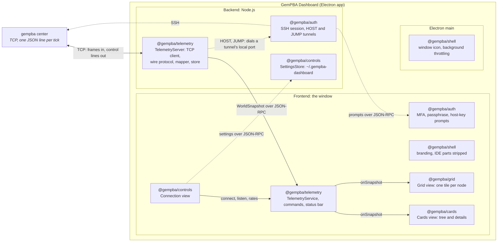
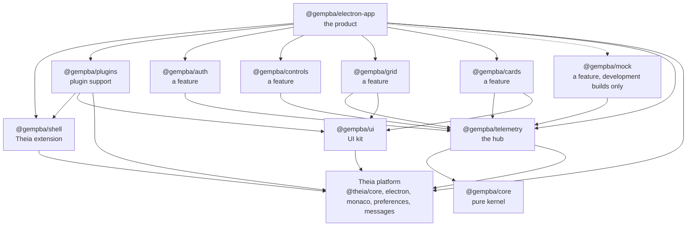
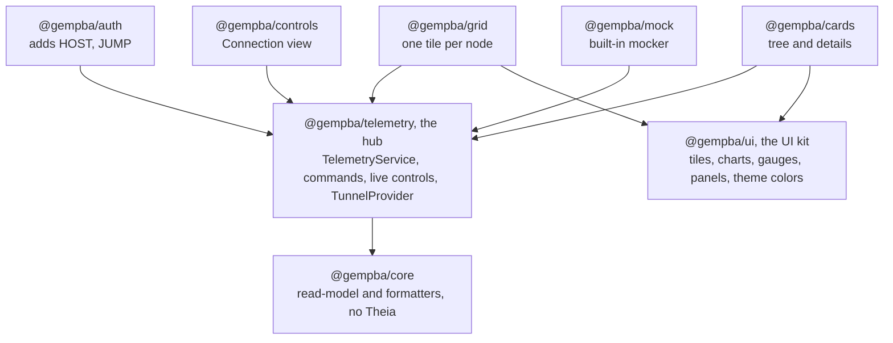

# Architecture

GemPBA Dashboard is a desktop app that shows live telemetry from the [GemPBA](https://github.com/rapastranac/gempba) parallel framework. It is built on the [Eclipse Theia](https://theia-ide.org) platform (1.76.0) and runs as an Electron app written in TypeScript.

The rule that shaped the design, carried over from the original Java/SWT version:

> The UI renders an immutable read-model; the wire format never reaches it.

In this version the rule is enforced by package boundaries and by a process boundary: the wire format is parsed in the backend process, and only the clean read-model is sent to the window.

> This document grows with the migration (umbrella issue #20). Sections marked *coming* describe planned work.

---

## Node and TypeScript in Java terms

| Java world | This project |
|---|---|
| Maven, `pom.xml` | npm, `package.json` |
| Multi-module reactor | npm workspaces: every folder under `theia/` is one package |
| `~/.m2` jars | `node_modules/`, downloaded prebuilt |
| `javac` | `tsc`: TypeScript compiles to JavaScript; `tsc -b` builds the packages in dependency order (`tsconfig.json` `references`) |
| JUnit, AssertJ | mocha, chai |
| Spring, Guice (dependency injection) | inversify, Theia's DI container |
| JVM | Electron, which bundles Node.js (backend) and Chromium (the window) |

---

## How the app runs

An Electron app is three cooperating processes. Our packages each contribute to one or more of them, on top of the shared kernel and the Theia platform.



- **Electron main** owns native windows. `@gempba/shell` sets the GemPBA icon on them here, and turns Chromium's background throttling back on once the frontend is ready, so a minimized window counts as hidden.
- **Backend** (Node.js) owns the TCP connection and, in HOST and JUMP mode, the SSH session that tunnels it. Each window gets its own `TelemetryServer`, which parses each telemetry line, maps it to a `WorldSnapshot`, and writes refresh-rate control lines back on the same socket.
- **Frontend** (Chromium) draws the UI. `TelemetryService` receives `WorldSnapshot`s from the backend over Theia's built-in JSON-RPC messaging, never raw wire frames, and hands them to the views.

---

## Packages



| Package | What it holds | Java equivalent | Uses Theia? |
|---|---|---|---|
| [`@gempba/core`](theia/gempba-core) | read-model (`WorldSnapshot` → nodes → sockets → workers), `NodeUtilization`, `CoreHeat` (the estimated load on each CPU), formatters, connection config and refresh rates (`RefreshInterval`, `RefreshRates`), `NodeHistoryStore` and `WorkerHistoryStore` (rolling history, live rates, throughput), `FrameCadence` (how often frames actually arrive), `SshEndpoint` | `core` | no: plain TypeScript, shared by backend and frontend |
| [`@gempba/telemetry`](theia/gempba-telemetry) | the hub. Backend: wire protocol, `TelemetryClient` (TCP), `WorldSnapshotMapper`, `TelemetryStore`, `TelemetryServer` (one per window), the `TunnelProvider` contribution point (LOCAL built in), `MockEmitter` (a stand-in gempba center replaying a recording, for the specs). Frontend: `TelemetryService`, `NodeHistoryService` and `WorkerHistoryService` (the API features inject), the refresh rate settings, the live controls menu with the rate chip it puts on every `LiveTelemetryView` tab, the GemPBA commands and status bar entry | `adapters` | yes |
| [`@gempba/shell`](theia/gempba-shell) | branding (About dialog, title-bar logo, window icon, splash, the macOS app menu), stripping the IDE features Theia brings along (commands, menus, shortcuts, views, editor and workspace settings) through the `ShellContribution` point other packages add to, never opening a workspace, and letting a minimized window count as hidden | — | yes |
| [`@gempba/plugins`](theia/gempba-plugins) | plugin support: Theia's VS Code plugin runtime and the Extensions view, to install extensions such as color themes from Open VSX, with the IDE parts the runtime brings stripped again through the shell. Removable: drop it from the app and the runtime goes with it | — | yes |
| [`@gempba/auth`](theia/gempba-auth) | a feature. Backend: `RemoteConnection` (one authenticated SSH session on `ssh2`, HOST and JUMP forwards), the HOST and JUMP `TunnelProvider`s, `KnownHosts` and `HostKeyVerifier` (trust on first use). Frontend: `AuthPromptImpl` (MFA, passphrase and host-key prompts) | `adapters` (`RemoteConnection`), `ui` (`SwtAuthPrompt`) | yes |
| [`@gempba/controls`](theia/gempba-controls) | a feature. Frontend: the Connection view (session, target, and the refresh rates through the hub), which only drives `TelemetryService`, and `RememberedRatesMove`, which moves the rates the view used to keep over to the hub's settings once. Backend: `SettingsStore`, the remembered settings in `~/.gempba-dashboard/settings.json` (the Java app's file), and `RememberedSettings` with the recents | `adapters` (`SettingsStore`), `ui` (`SwtSettingsView`) | yes |
| [`@gempba/ui`](theia/gempba-ui) | the UI kit, shared by the views: `Tile`, `TileGrid`, `Sparkline` (SVG, from the pure `SparklineGeometry`), `MeterBar`, the instrument-panel parts (`Panel`, `HeroStat`, `Gauge`, `HeatStrip`, `LiveIndicator`, `RateReadout`, `SegmentedControl`, `EmptyState`) with their pure logic (`GaugeGeometry`, `NiceScale`, `HeatScale`, `Liveness`, `Trend`, `RateAgreement`, `MotionTiming`), `PropertySheet` (label and value rows under section headings), `DataTable`, `VisibleRefresh` (refresh only while visible), the `gempba.*` theme colors, and the GemPBA Dark and Light color themes with the theming service that keeps them current. No data, no features | `ui` (`NodeTile`'s drawing) | yes |
| [`@gempba/grid`](theia/gempba-grid) | a feature. The Grid view in the main area: one Task Manager style tile per node (utilization now, about two minutes of CPU history, memory), built from the UI kit; `GridTiles` turns a snapshot and its history into formatted tiles. A click selects a tile; a double-click or Enter opens its node in whichever view handles node links | `ui` (`SwtGridView`, `NodeTile`), `GridPresenter` | yes |
| [`@gempba/cards`](theia/gempba-cards) | a feature. The Cards view in the main area, master and detail in Theia's own `SplitWidget`: on the left the Node → Socket → Worker hierarchy in Theia's own `TreeWidget` (`CardsTree` builds rows lazily), on the right the picked row's details (`CardsText` words them like the Java cards: a worker's counters, a socket's core usage), a dialog listing a worker's outgoing peers, and Expand Selected and Collapse All on its tab, as in Theia's explorer | `ui` (`SwtCardsView`, `NodeCard`, `SocketCard`, `CoresCard`, `WorkerCard`), `CardsPresenter` | yes |
| [`@gempba/mock`](theia/gempba-mock) | a feature in development builds only: the built-in mocker. Backend: `MockRun` (a seeded gempba run, stepped in simulated time), `MockCenter` (broadcasts it as gempba's center does), the Local TCP and the Host and Jump SSH endpoints, and `MockService`, one mock for the whole app. Frontend: the Mock panel, the GemPBA Mock commands and a status bar entry while it runs. `npm run mock` runs the same engine without the app | the Python [gempba-dashboard-mocker](https://github.com/apdistributedsystems/gempba-dashboard-mocker) | yes |
| [`@gempba/electron-app`](theia/electron-app) | the product: lists the Theia packages and our extensions; built and packaged | `app` | yes |

### Where the wire format lives

- The gempba wire format (snake_case JSON frames in, control lines out) is described in exactly one file: [`theia/gempba-telemetry/src/node/protocol/wire-protocol.ts`](theia/gempba-telemetry/src/node/protocol/wire-protocol.ts). It lives under `src/node`, which only the backend loads.
- [`WorldSnapshotMapper`](theia/gempba-telemetry/src/node/telemetry/world-snapshot-mapper.ts) is the only place that turns wire types into the camelCase read-model from `@gempba/core`.
- Only `@gempba/core` types cross into the frontend: the JSON-RPC contract in [`telemetry-protocol.ts`](theia/gempba-telemetry/src/common/telemetry-protocol.ts) carries `WorldSnapshot`s, connection states and status text.

---

## Where you can see Theia

1. [`theia/electron-app/package.json`](theia/electron-app/package.json): its dependencies are `@theia/*` packages, it declares `"theia": { "target": "electron" }`, and its scripts call the Theia CLI (`theia build`, `theia start`). The product has no code of its own; Theia generates the startup code from this file.
2. `node_modules/@theia/`: the platform itself, downloaded prebuilt. We never compile it.
3. [`theia/gempba-shell/package.json`](theia/gempba-shell/package.json): the `"theiaExtensions"` entries tell Theia which module to load in the frontend, which in Electron main, and which only when the frontend runs in Electron (`frontendElectron`, here the macOS app menu). This is what makes a package a Theia extension.
4. [`shell-frontend-module.ts`](theia/gempba-shell/src/browser/shell-frontend-module.ts): a `ContainerModule` (think Guice module) that registers *contributions*. Theia collects every extension's contributions at startup.
5. `theia/electron-app/src-gen/` (generated by `theia build`, not committed): the startup code importing each extension's modules.
6. [`telemetry-backend-module.ts`](theia/gempba-telemetry/src/node/telemetry-backend-module.ts) and [`telemetry-frontend-module.ts`](theia/gempba-telemetry/src/browser/telemetry-frontend-module.ts): one service split across two processes. The backend registers `TelemetryServer` per window with `ConnectionContainerModule` and `bindBackendService`; the frontend gets a proxy to it from `ServiceConnectionProvider.createProxy`, and every call or notification travels as a JSON-RPC message.

### How an extension plugs in

```ts
// theia/gempba-shell/src/browser/shell-frontend-module.ts (excerpt)
export default new ContainerModule((bind, _unbind, _isBound, rebind) => {
    bind(FilterContribution).to(ShellFilterContribution).inSingletonScope();           // drop IDE-only contributions
    bind(ShellCommandStripper).toSelf().inSingletonScope();                             // one object, bound under
    bind(FrontendApplicationContribution).toService(ShellCommandStripper);              // two contribution points
    rebind(AboutDialog).to(GemPbaAboutDialog).inSingletonScope();                      // replace Theia's About dialog
    rebind(PreferenceTreeGenerator).to(UiPreferenceTreeGenerator).inSingletonScope();  // Settings: UI settings only
});
```

---

## How extensions connect

Every feature is its own Theia extension, and features plug into one hub, `@gempba/telemetry`, never into each other. Adding or removing a feature means touching that package plus one line in [`theia/electron-app/package.json`](theia/electron-app/package.json), the product's list of extensions (like a Maven `<modules>` list).



Arrows mean "depends on"; they only point down. Extensions talk through three Theia mechanisms:

| Mechanism | Java analogy | Provided by | Used by |
|---|---|---|---|
| **Service**: an interface plus a DI token, injected with `@inject` | interface + Guice binding | telemetry: `TelemetryService`, `NodeHistoryService`, `WorkerHistoryService` ([`telemetry-service.ts`](theia/gempba-telemetry/src/common/telemetry-service.ts)) | controls, grid, cards |
| **Contribution point**: a socket the host loops over through a `ContributionProvider` | Eclipse extension point, `ServiceLoader` | telemetry defines `TunnelProvider` ([`tunnel-provider.ts`](theia/gempba-telemetry/src/node/tunnel/tunnel-provider.ts)), with LOCAL built in | auth fills it with HOST and JUMP |
| **Theia's shared services**: commands, selection, opening, events | listeners, an event bus, `Desktop.open` with registered handlers | Theia core: `CommandRegistry`, `SelectionService`, `OpenerService` | grid and cards publish the picked node as a `NodeSelection` ([`node-selection.ts`](theia/gempba-telemetry/src/common/node-selection.ts)) and follow each other's. Opening a Grid tile opens its node's `NodeLink` (`gempba-node:alpha`, [`node-link.ts`](theia/gempba-telemetry/src/common/node-link.ts)); cards registers the `OpenHandler` that shows it. Later views can join without importing either |

A feature's whole coupling to the stream is one injected interface:

```ts
// a view in a feature package (sketch)
@inject(TelemetryService) protected readonly telemetry: TelemetryService;

this.toDispose.push(this.telemetry.onSnapshot(snapshot => this.update(snapshot)));
```

- **Auth opens the road; telemetry drives on it.** In HOST and JUMP mode a `TunnelProvider` opens the SSH tunnel and hands telemetry a local port, which the TCP client reads exactly as in LOCAL mode. Views never learn which mode, tunnel or credentials are in use.
- **A dropped session is reported, not retried.** A `Tunnel` fires `onClose` when its session ends on its own (the server closing it, a lost network, ssh2's keepalive giving up), never after a deliberate `close()`. The telemetry server then tears the stream down, goes to DISCONNECTED and says "SSH session to … closed (…); connect again", since nothing can stream again without authenticating. A lost TCP stream over a live session, or in LOCAL mode, is still retried: there the target may come back on its own.
- **Providers live per window.** Tunnel providers are bound in a `ConnectionContainerModule`, next to that window's `TelemetryServer`, so an SSH provider prompts the window that asked: auth reaches the window's `AuthPrompt` through `bindFrontendService`, and the frontend serves it with `ServiceConnectionProvider.createHandler`. That is the reverse direction of `TelemetryService`: the backend calls the frontend and waits for the user's answer.
- **Ready for sessions.** `TelemetryService` is the *active* session's stream. Several sessions switched live can come later as a hub change plus a new feature, with no change to the views.
- **The hub owns the live controls.** The refresh rates, the only control gempba accepts, belong to the hub: `TelemetryService.rates`, `setRates` and `onRatesChange`, kept as the user's settings `gempba.telemetry.workerIntervalMs` and `nodeIntervalMs` in [`rate-settings.ts`](theia/gempba-telemetry/src/browser/rate-settings.ts). Every window sends them to gempba before every Listen and Connect, and again whenever they change, so a change in one window applies in all. The controls are one menu, `TelemetryMenus.CONTROLS` (a submenu per rate with presets and Custom…, then Stop Listening and Disconnect), opened from the status bar entry and from a rate chip the hub draws on the tab of every view marked as a [`LiveTelemetryView`](theia/gempba-telemetry/src/browser/live-telemetry-view.ts), as the Grid and Cards are. A new control is one command and one menu item in the hub, with no change to the views, which only mark themselves.
- **The File menu is the sessions' home.** The hub puts Connect…, Listen…, Stop Listening and Disconnect in the File menu's first group, `TelemetryMenus.SESSION`. A sessions feature (a FileZilla-like site manager, several sessions at once) adds its items to that group without touching the hub's commands.
- **The rules are checked.** [`configs/check-layers.js`](configs/check-layers.js) runs first in `npm test` and fails when a package depends on a `@gempba` package outside its layer: core on nothing, telemetry on core, shell and the UI kit on nothing, plugin support on the shell and the UI kit, a feature on core, telemetry and the UI kit only. Only the app may list features.
- **Every feature must be removable.** Each feature issue checks that the app builds, boots and works with that package dropped from the app. Without controls, the stream still runs from the File menu or the command palette: File > Listen… (F1 → `GemPBA: Listen…`) streams a local gempba, File > Connect… first opens an SSH session, and the rates change from the status bar or the palette (`GemPBA: Set Worker Refresh Rate…`). Without auth there is no Connect, only local listening.

GemPBA's features are Theia *extensions*, composed when the app is built, not VS Code plugins loaded at runtime: plugin views are limited to webviews, and a feature plugs into the hub through dependency injection. The VS Code plugin runtime is there for the user's own add-ons, such as color themes from Open VSX (see `@gempba/plugins` below).

---

## Key decisions

- **The smallest Theia set that boots.** `@theia/core` alone fails dependency injection: the command palette lives in `@theia/monaco`, the settings providers in `@theia/preferences`. The app uses `core`, `electron`, `monaco`, `preferences` and `messages`. What those drag in that a dashboard doesn't need is stripped by `@gempba/shell`, as the next decision explains.
- **IDE features are stripped by command, not by package.** The workspace, filesystem, editor and Monaco packages must stay, because the Settings page and Theia's core depend on them. And Theia's core contribution, which owns most File and Edit items, also does essential work (theme colors, the clipboard, the menu bar's own labels), so it can't be dropped either. So the shell removes features one command at a time:
  - **Commands:** [`ShellCommandStripper`](theia/gempba-shell/src/browser/shell-command-stripper.ts) unregisters every command in [`StrippedCommands`](theia/gempba-shell/src/browser/stripped-commands.ts) once all contributions have registered theirs, and removes their menu items. The list is grouped by reason (files, workspaces, code editors, settings JSON) and names each command by the constant Theia exports for it (`CommonCommands.SAVE`, `WorkspaceCommands.OPEN_FILE`), so a renamed or removed constant fails the build. A command's palette entry and shortcut go with it, so Ctrl+N, Ctrl+O and Ctrl+S do nothing, and on Windows Ctrl+W no longer closes the whole window.
  - **Contributions:** classes that only add IDE menus (the workspace's File and Edit items, and the editor menus, which also brought Selection and Go) are dropped whole with `FilterContribution`, matched by class, since class names are minified in production builds. The bottom panel's status-bar button goes too, as its command is stripped and no view lives there.
  - **Views:** every view is dropped unless it is on an allowlist ([`ShellViews`](theia/gempba-shell/src/common/shell-views.ts)): GemPBA's own (ids starting with `gempba-`) and the Theia views a package keeps, such as the Settings page. That drops Outline and Problems, the IDE views plugin support brings, and any a newer Theia adds.
  - **One mechanism for every package:** these lists are [`ShellContribution`](theia/gempba-shell/src/common/shell-contribution.ts)s (contributions and commands to strip, views and settings to keep). The shell registers its own lists as one, and a package that brings more of Theia, such as `@gempba/plugins`, registers its own, so removing that package removes its lists with it.
  - **Upgrades:** a listed command that is no longer registered is logged as a warning at startup (`gempba:ShellCommandStripper`), since Theia may have replaced it with one the list doesn't name. A newer Theia may also add new IDE commands, so a Theia upgrade re-checks the menus and the palette; the release smoke test checks the menus, side bar and status bar against an allowlist.
- **Plugins come back, the IDE stays out.** `@gempba/plugins` adds Theia's VS Code plugin runtime and the Extensions view, so a user can install extensions from Open VSX or a `.vsix`, color themes first. The runtime depends on about 27 more Theia packages (Terminal, Debug, SCM, Tasks, Notebooks, AI and MCP among them), so the package also strips what they bring, through the shell: their views by the allowlist, their remaining menus and commands by class ([`stripped-contributions.ts`](theia/gempba-plugins/src/browser/stripped-contributions.ts)), and AI switched off. Plugins still get the services behind those contributions, which are injected directly: a plugin may still run a task, but the dashboard offers none.
  - **Safety:** a plugin runs with the user's rights and can read anything they can, such as `~/.ssh`. The Extensions view lists only verified Open VSX publishers by default (`extensions.onlyShowVerifiedExtensions`, on the Settings page), and nothing installs without the user's click.
  - **Where plugins live:** in Theia's own folder, `~/.gempba-dashboard/theia` (`deployedPlugins/`, plus `extensions/` for `.vsix` files dropped in). Settings a plugin contributes show on the Settings page.
  - **Uninstalled themes:** Theia caches every registered color theme in IndexedDB so the active one applies before plugins load, and restores the whole cache at each start, so an uninstalled plugin's theme would stay selectable, and active if it was. Once plugins have started, [`StaleThemeCleanup`](theia/gempba-plugins/src/browser/stale-theme-cleanup.ts) drops the cached themes no installed plugin declares and nothing registered again, and resets the theme setting if it named one. It asks the UI kit's [`CacheAwareThemingService`](theia/gempba-ui/src/browser/cache-aware-theming-service.ts), a subclass of Theia's `MonacoThemingService` that keeps the registration of every theme it restores; it copies Theia's eight-line `restore()`, to recheck on Theia upgrades.
- **GemPBA Dark and Light are the default themes.** The UI kit ships them as VS Code color themes ([`src/common/themes`](theia/gempba-ui/src/common/themes)), the only place a hex color appears, and registers them at startup. They are built from the logo's teal and green, and set every `gempba.*` color, the status bar (including `statusBar.noFolder*`, as no workspace ever opens), buttons, lists, menus and the `charts.*` hues. Theia draws secondary buttons with its own `secondaryButton.*` ids rather than VS Code's `button.secondary*`, so the themes set both. A spec ([`gempba-themes.spec.ts`](theia/gempba-ui/src/common/gempba-themes.spec.ts)) fails if a theme misses a `gempba.*` color, or if text falls below 4.5:1 contrast or a chart color below 3:1 against its background, so every color added later goes into both themes.
  - **Following the OS:** the app's `defaultTheme` names GemPBA Light and Dark, and Theia picks one by the OS mode at launch. Theia 1.76 doesn't follow a mode change while running (`window.autoDetectColorScheme` isn't implemented), and only turns `defaultTheme` into the theme setting's default when the frontend config has a `preferences` object, hence the empty `"preferences": {}` in [`theia/electron-app/package.json`](theia/electron-app/package.json).
  - **The cache never wins over the app:** Theia restores its theme cache after the UI kit has registered its themes, so a profile would keep the colors of the first version it cached, through every upgrade. The UI kit's [`CacheAwareThemingService`](theia/gempba-ui/src/browser/cache-aware-theming-service.ts) replaces Theia's `MonacoThemingService`: its restore skips the themes registered this session, and it applies them again if Theia reads the remembered theme from the cache after they registered.
  - **First launch:** from the second launch on, the cache applies the remembered theme before the frontend loads. The very first launch has no cache, so Theia's own theme can show for a moment.
- **Settings are about the UI and GemPBA only.** The Settings page lists the settings [`UiPreferences`](theia/gempba-shell/src/common/ui-preferences.ts) allows: GemPBA's own (`gempba.*`, such as the refresh rates, in a GemPBA section right after Commonly Used), the theme, the window (title bar, menu bar, zoom), tabs, trees, the status bar and notifications. It opens on those instead of Theia's code-editor ones. The editor, file and workspace settings are left off the page but keep their values and defaults, so the code reading them is unaffected. An allowlist is used here, so settings a later Theia adds stay off the page too; settings that installed plugins contribute are shown. Settings have one scope, the user's: with no workspace open, Theia's Settings page offers only the User tab, as VS Code does with no folder open, and there is no `settings.json` editor.
- **Theia's state is the dashboard's own, and no workspace opens.** Theia keeps its state (the Settings page's `settings.json`, recent workspaces) in `~/.theia` by default, a folder every Theia app on the machine shares. There, another app's recent workspace made the dashboard reopen it on launch. The app's `configurationFolder` moves that state to `~/.gempba-dashboard/theia`, beside the Connection view's `settings.json`. And [`ShellWorkspaceService`](theia/gempba-shell/src/browser/shell-workspace-service.ts) starts every window without a workspace, since the dashboard opens no files or folders.
- **The macOS app menu is the dashboard's.** Theia builds it with Electron's own About panel. The shell's `frontendElectron` module replaces that with the GemPBA About dialog and adds Settings… (Cmd+,), where macOS apps keep it; Services, Hide and Quit stay native.
- **The read-model is plain data.** It travels over JSON-RPC, where class methods don't survive, so each Java record became a readonly interface plus a same-named namespace for its methods (`WorldSnapshot.forHost(snapshot, host)`). `StructureKey` is a sorted array rather than a `Set`. Stateful helpers that never cross processes (`NodeHistoryStore`, `WorkerHistoryStore`, `TelemetryStore`) stay classes.
- **Output matches the Java app.** `NumberText` reproduces Java's `String.format` rounding (`1.005` → `"1.01"`, where JavaScript's `toFixed` gives `"1.00"`) and groups thousands without depending on the OS locale.
- **The kernel never touches the OS.** Anything Java read implicitly (environment variables, the OS user name) is passed in: `Config.from(args, env)`, `SshEndpoint.parse(spec, defaultUser)`.
- **Existing settings keep working.** Enums are string enums (`'JUMP'`) like the existing `settings.json`, and `of()` factories fill in fields that older files lack.
- **Every color comes from the theme.** The views hard-code no color: the UI kit registers `gempba.*` theme colors (tiles and panels, headline figures, the CPU, memory, task, network and idle charts, gauge tracks, CPU heat, the live states), each defaulting to a standard theme color such as `charts.blue` or `editorWidget.background`, and components use them only as `var(--theia-gempba-…)`. A heat strip's shades are mixed in CSS (`color-mix`) from just two of them, the idle and the busy one, so not even a shade is a literal color. Any theme, including a VS Code theme installed as a plugin, restyles the dashboard with no code change, and can override a `gempba.*` color by id.
- **Hidden views do no work.** Snapshots arrive several times a second. Each view refreshes through the UI kit's `VisibleRefresh`: while it is hidden (a background tab, a collapsed panel, a minimized window) a snapshot only marks it stale, and it catches up once when shown, reading the latest snapshot then. Measured in the app: the view in front updates, the one behind makes no DOM changes at all, and neither does anything while the window is minimized. A visible view redraws at most ten times a second, however fast frames arrive: a refresh sooner than 100 ms after the last waits, and the snapshots meanwhile fold into it, so it still ends on the latest one. The node and worker histories keep folding while hidden, so a graph is continuous when shown again. They hold the 120 samples a graph draws, per node and per worker, and drop the nodes and workers that leave the run, so memory stays flat however long the app runs.
- **A minimized window is hidden, like a background tab.** Theia turns Chromium's background throttling off so that a window started minimized still finishes loading, which also keeps the page reporting itself visible when minimized. `@gempba/shell` turns it back on once the frontend reports it is ready (and off while it reloads), so the standard Page Visibility API works and `VisibleRefresh` uses it. Without the shell the app still works; a minimized window just keeps drawing.
- **Opening a node goes through Theia's opener service.** The Grid never names the view that shows a node: it opens a `NodeLink`, and Theia picks the `OpenHandler` that answers highest. Cards answers `NodeLink.VIEW_PRIORITY` (500) and brings its tab forward with the node picked and expanded; a dedicated node view could later answer higher and take over with no Grid change. The hub registers a fallback that answers 200 and opens nothing, because Theia's text editor claims every URI at 100: without it, removing Cards would leave the editor trying to open `gempba-node:alpha` as a file.
- **Stock Theia first.** The Cards view is Theia's own `SplitWidget` holding Theia's own `TreeWidget`, which draws only the rows on screen; the Cards tree builds a row's children only when it is expanded, so the collapsed parts of a large cluster cost nothing. Rows keep their ids, so expansion and selection survive every refresh. The tree is for finding a node, socket or worker; what it holds shows in the details pane beside it, so long lists of counters never crowd the tree. As in the Java cards, the first node opens with its sentinel's socket and the sentinel worker picked. The outgoing-peers list is a stock Theia dialog. Custom visuals are used where Theia has nothing, as for the Grid's tiles.
- **Reusable visuals live in the UI kit.** Grid, cards and the later detail views share its tiles, charts, gauges and panels, from `@gempba/ui`, which holds no data and depends on no other `@gempba` package. Charts and gauges are hand-drawn SVG; a charting library such as uPlot (MIT, no dependencies) is kept for the interactive detail charts. Their geometry and logic are pure functions in `src/common` with specs, and every component has a spec too, rendering it to markup with React's server renderer, like an HTML snapshot test in Java.
- **Motion is brief, and optional.** Only transforms, opacity and stroke offsets animate, which the browser does without laying the page out again: a meter slides by `scaleX`, a gauge sweeps by its arc's dash offset. A change takes most of a frame interval ([`MotionTiming`](theia/gempba-ui/src/common/motion-timing.ts): 80% of it, at most 400 ms, and none below 80 ms, where it would read as jitter), set as `--gempba-motion-duration`, so a value settles before the next frame moves it. Nothing animates when the OS asks for reduced motion.
- **The mocker imitates gempba as it is, in development builds only.** `@gempba/mock` stands in for gempba's center so the views can be checked without a cluster, and it sends what gempba sends: the topology in every frame, each worker's and node's latest frame broadcast every 500 ms whatever the worker rate (gempba's `center_tcp_server.cpp`), a repeated frame keeping its sequence number, `process_threads` as the pool size plus one, control values clamped to 50…600000 ms, and zeros where gempba leaves fields at zero (socket CPU and use, network, disk). A Fidelity setting fills those fields instead, for views that will need them.
  - **One run, consistent and repeatable:** [`MockRun`](theia/gempba-mock/src/node/sim/mock-run.ts) steps a branch-and-bound run in fixed simulated time from a seed, so the same seed and steps give the same frames. Each worker explores one received subtree at a time on its pool (tasks finish as Poisson draws) and reports itself available when it is done. The counters follow from that, as gempba's do: sent and received equal the sums over the edges, running stays within the pool, idle time and CPU follow the busy threads, and an idle worker still shows about one core, since gempba's main thread polls MPI without sleeping. Scenarios (slow tasks, a finite tree that ramps up and drains, imbalanced, bursty) and faults (a stalled node, a restarted worker, dropped clients, a worker added or removed, a malformed line, the run ending) show how the views cope. A frame of 16 nodes × 32 workers takes a few milliseconds to build and serialize.
  - **gempba's schedulers, as its MPI code runs them** ([`mpi_semi_centralized_scheduler.hpp`, `mpi_centralized_scheduler.hpp`](https://github.com/apdistributedsystems/gempba)), fixed for the run as gempba's are. Semi-centralized: the center seeds the root and then only pairs each running worker with an available rank, which the worker sends one task to, with nothing else in flight; nothing ever queues, so every pending count is 0. Centralized: running workers send spare tasks to the center while it isn't full (1000 tasks per process, or 10 GiB), and it hands the biggest to each available worker; its queue is the only pending count. A worker's edges reach every rank it ever sent to, so at a few hundred workers a line runs to megabytes, as gempba's would. A further scheduler, such as a decentralized one with a queue on every worker, would be one more branch here.
  - **Like the real road:** each mode is what it stands for. Local is gempba on this machine and Host gempba on one VM, so each runs one node; Jump reaches a cluster's compute nodes behind a login node, the realistic case, so only Jump takes a node count. Local mode is a TCP port on loopback. Host and Jump are an `ssh2` server on loopback standing in for the VM or the login node: publickey (the user's keys, or a key pair it generates), an optional Duo-style passcode, and in Jump mode the dashboard's own `ssh -N -L` hop over exec, refused for an unknown compute node as ssh refuses it. It keeps its host key in `~/.gempba-dashboard/mock/` and never writes `~/.ssh`.
  - **One mock for the app:** [`MockService`](theia/gempba-mock/src/node/mock-service.ts) is application-wide, like `SettingsServer`, so every window sees the same mock and its log, and Connect this window only drives the hub's `TelemetryService`, as the Connection view does.
  - **Kept out of installers:** the app lists it under `gempbaDevExtensions`, and the production build drops those from its extensions, so no installer carries a mock or an SSH server. The release smoke test fails an installer that shows the Mock panel.
- **Remembered connections are not Theia preferences.** The Connection view keeps the Java app's `~/.gempba-dashboard/settings.json` (one block per mode, recents capped at ten), served by one application-wide `SettingsServer`, so an existing user's hosts and targets come back pre-filled. The view never connects on its own. The file used to hold the refresh rates as well; they are the hub's settings now, and at startup [`RememberedRatesMove`](theia/gempba-controls/src/browser/remembered-rates-move.ts) moves any rate still changed there over to them, once, leaving the defaults in the file (which keeps the fields, as the Java app reads them). The view loads the file only after that, so it never saves an old rate back.
- **Parsing follows the Java contract.** Unknown wire fields are ignored, missing numbers read as 0, and missing objects or lists stay `undefined`. A topology node without `sockets` falls back to the live frame's socket count, while `sockets: []` means zero sockets.
- **Utilization is per allocation**: a node's CPU is `clamp(Σ worker CPU ÷ |allocated cores|, 0, 100)`, the user's own work on the user's own cores, excluding other tenants on a shared node.
- **Live rates are measured between a worker's own frames.** gempba's counters (tasks completed, idle time) are totals since the worker started, so a per-second rate is the difference between two of a worker's frames, timed on the worker's own clock (`worker_local_ms`) rather than on when the frames reached the dashboard. The frames repeat a worker's latest values until it sends new ones, so [`WorkerHistoryStore`](theia/gempba-core/src/common/history/worker-history-store.ts) takes a sample only from a frame with a new sequence number, and a counter that goes back, as when a worker restarts, gives no rate rather than a negative one. A node's throughput is the sum of its workers' latest rates, and the cluster's is the sum over every node. Each series keeps 120 samples (a minute at the default 500 ms) in a `RingSeries`, a fixed `Float64Array`: like a Java `ArrayDeque` capped at a size, but allocated once.
- **gempba acknowledges no rate change, so the rate is measured.** [`FrameCadence`](theia/gempba-core/src/common/history/frame-cadence.ts) keeps the latest intervals between two new frames of one sender (a worker by its sequence number, a node by its sentinel's clock), measured on the sender's own clock, and the hub reports their median as the observed rate. A repeated frame adds nothing, and a dropped one moves the median little. The chip and the status bar show it on hover beside the rate as set, so a rate gempba clamped or ignored shows.
- **The load on each CPU is an estimate.** The frames give each worker's CPU, not each CPU's. [`CoreHeat`](theia/gempba-core/src/common/policy/core-heat.ts) spreads a worker's CPU evenly over the CPUs it may run on, or over its socket's CPUs when it is unrestricted, as core usage does, so a worker allowed on two sockets heats both. A CPU carrying more than a whole CPU of work (above 105 %, allowing for sampling noise) is flagged as oversubscribed: workers sharing CPUs they can't all fill.
- **Only SSH has a session.** Connect pays the authentication (keys, MFA) once and Listen points that session at a gempba, as often as needed. A local gempba has nothing to authenticate, so Listen streams it straight away and Stop ends it, back to disconnected; Connect exists only for HOST and JUMP.
- **One telemetry session per window.** `TelemetryServer` lives in Theia's per-connection container, so each window has its own and closing the window closes its connection. That container binds a `ContributionProvider` of its own, which hides the application's, so the `TunnelProvider` contribution provider and all tunnel providers are bound inside connection modules.
- **SSH follows the Java client and OpenSSH.** One session is authenticated once (the explicit key, then the default `~/.ssh` identities, then up to three keyboard-interactive rounds for MFA) and every target is a cheap forward over it. JUMP runs `ssh -N -L` on the login node over a PTY exec channel, so the hop uses the cluster's own node-to-node trust and closing the channel hangs it up. Host keys are checked against the user's own `~/.ssh/known_hosts`: a known key passes, a changed key is refused without asking, and a new host is confirmed once and remembered.
- **`ssh2` stays pure JavaScript.** Its optional native install scripts (`ssh2`, `cpu-features`) are denied in `allowScripts`, so there is no extra native module to build per OS or package.
- **Connections drop stale work by epoch.** Every stop, disconnect or new target bumps an epoch; callbacks and late tunnel opens from an older epoch are discarded, as in the Java `ConnectionController`. The refresh intervals are sticky and re-sent on every (re)connect.
- **Dead Java code was not ported**: `ConnectionSpec`, and `SshCommand`, which only served the never-used child-process tunnel. Both remain in git history.

---

## Build, run and test

```
npm ci                    # install (Node 22)
npm run build             # tsc -b, then theia build
npm run rebuild:electron  # once after installing: native modules for Electron
npm start                 # launch the app
npm test                  # check the layering, lint, compile, then run every package's specs
npm run lint              # the code style alone; npx eslint --fix . repairs most of it
npm run mock              # after a build: the built-in mocker on 127.0.0.1:9000 (npm run mock -- --help)
npm run package           # installers for this OS in theia/electron-app/dist/
```

To see live data without a cluster, start the app and open the Mock panel (the beaker icon on the left), or press F1 and run `GemPBA Mock: Start…`. Pick how the dashboard reaches the mock and what the run does, press Start, then Connect this window. The Grid tab shows one tile per node (double-click one to open it in Cards), the Cards tab the node, socket and worker tree with the picked row's details, and the status bar the node count. The panel also changes the run live, injects faults, and lists what to type into the Connection view to reach the mock by hand. Without the app's mocker, as for an installed app, `npm run mock` serves the same run: in the Connection view pick Local and press Listen (port 9000).

- Specs live next to their sources (`*.spec.ts`) and run from the compiled `lib/`. The root [`.mocharc.js`](.mocharc.js) lets an IDE run or debug a single spec file: it builds the package and runs the compiled copy, so breakpoints map back to the TypeScript through source maps.
- Native modules exist in two builds: `npm rebuild` targets Node.js (tests), `npm run rebuild:electron` targets Electron (the app).
- The app keeps its state in `~/.gempba-dashboard`: `settings.json` for the Connection view, and `theia/` for Theia's own (the Settings page's `settings.json`), set by `configurationFolder` in [`theia/electron-app/package.json`](theia/electron-app/package.json). The mocker keeps its SSH keys and the configuration last started in `mock/`.
- npm only runs the install scripts listed under `allowScripts` in the root `package.json`.
- On Windows, building from source needs Visual Studio's C++ tools with the **MSVC Spectre-mitigated libs (Latest)** component: the plugin runtime's `@vscode/windows-ca-certs` compiles natively and requires it, and npm silently skips that optional package if the compile fails, which then fails the app build.
- Code style: [`eslint.config.mjs`](eslint.config.mjs) holds the rules, after Theia's own (single quotes, semicolons, braces on every block, lines up to 180), and [`.editorconfig`](.editorconfig) the indentation and line endings. `npm test`, and so CI, fails on any violation. WebStorm needs no setup: it reads the `ij_` keys in `.editorconfig`, so its Reformat Code produces this style, and it shows ESLint's findings in the editor. Nothing under `.idea` is committed.
- CI ([`.github/workflows/ci.yml`](.github/workflows/ci.yml)) installs, compiles, tests and builds on Linux, Windows and macOS, through the shared [`setup-node-theia`](.github/actions/setup-node-theia/action.yml) action. Runners come from the `RUNNER_LINUX`, `RUNNER_WINDOWS`, `RUNNER_MACOS` and `RUNNER_MACOS_INTEL` repository variables, with GitHub's hosted runners as defaults.
- Installers: [`electron-builder.yml`](theia/electron-app/electron-builder.yml), after the Theia IDE's. `npm run package` rebuilds the native modules for Electron, builds the production bundle and packages it: an NSIS installer on Windows, a dmg and zip on macOS, an AppImage and deb on Linux. Only the bundled `lib/` and `src-gen/` ship, without `node_modules` or source maps, which also keeps the replay emitter's fixtures out. The production bundle leaves out the extensions the app lists under `gempbaDevExtensions`, the mocker among them: [`configs/build-production.js`](configs/build-production.js) drops them from the dependencies Theia collects extensions from, in memory, before building. Each OS packages on its own runner, because native modules are compiled against Electron's ABI per OS and architecture; macOS arm64 and x64 are separate builds. The icon is [`branding/favicon.svg`](branding/favicon.svg) rendered at 1024 px by [`branding/render-icon.js`](branding/render-icon.js). The installers are unsigned: Windows shows "Unknown publisher", and macOS asks the user to allow the app once.
- Releasing: run the Prepare release workflow ([`prepare-release.yml`](.github/workflows/prepare-release.yml)) with the version. It sets every package to it ([`configs/set-version.js`](configs/set-version.js)), drafts the release notes in `docs/releases/` and opens a PR to `main`. After curating the notes and merging, push the `vX.Y.Z` tag: [`release.yml`](.github/workflows/release.yml) packages on Linux, Windows, macOS arm64 and macOS x64, boots each packaged app ([`configs/smoke-test.js`](configs/smoke-test.js) fails on any frontend error, on a menu, side-bar view or status-bar item outside the dashboard's, or unless the fixture theme plugin in [`configs/fixtures/plugins`](configs/fixtures/plugins) loads) and attaches the installers to the GitHub Release. A manual run, or a PR that changes the packaging, does the same without publishing.
