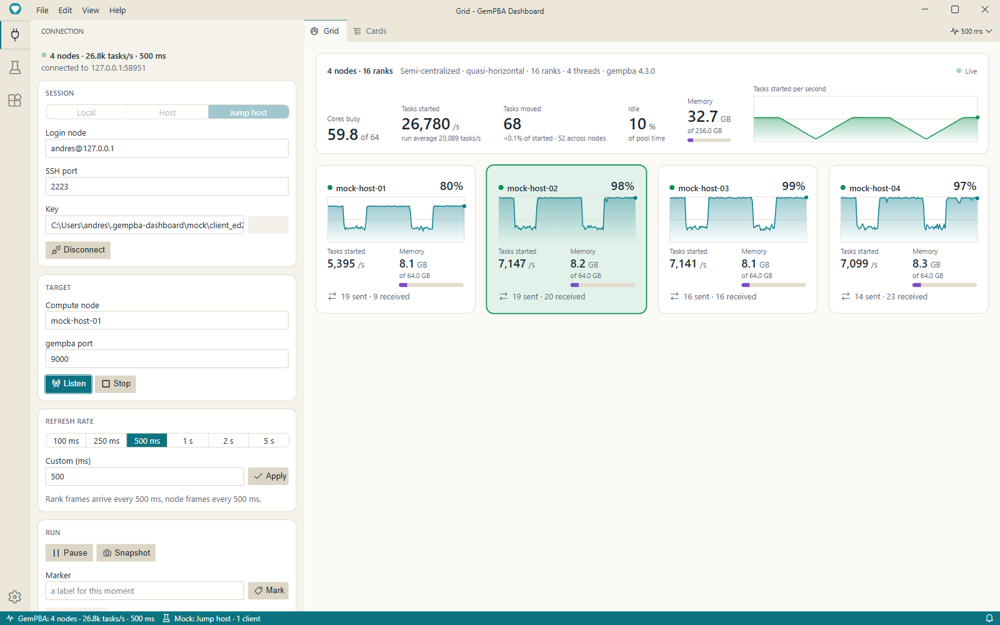
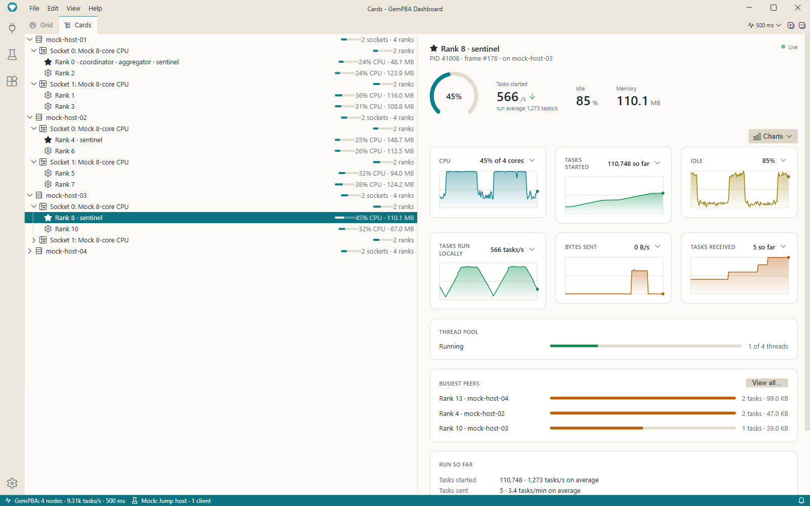
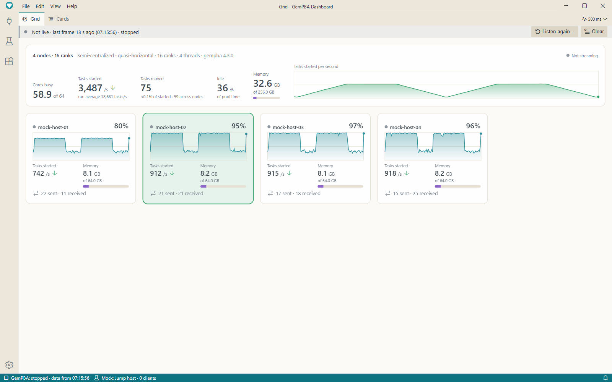
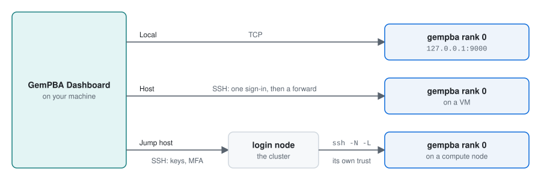

# GemPBA Dashboard

[](https://github.com/rapastranac/gempba-dashboard/actions/workflows/ci.yml)
[](https://github.com/rapastranac/gempba-dashboard/releases/latest)
[](LICENSE)


[](https://deepwiki.com/rapastranac/gempba-dashboard)

A desktop telemetry dashboard for the [GemPBA](https://github.com/rapastranac/gempba) hybrid parallel framework: watch a run live, node by node and rank by rank, and see how hard your allocation is actually working.

<p align="center">
  
</p>

---

## What it shows

- **The whole run at a glance.** The **Grid** sums the run up on top: the cores busy, the tasks started each second with their history, the tasks moved between ranks and across nodes, how idle the ranks that run tasks are, the memory, and how the run is set up (scheduler, load balancer, ranks, threads, gempba version). Below, one tile per node shows its CPU and its history, its tasks started, its memory, and the tasks it sent and received. A node whose ranks stop sending fades on its own.
- **Every node, socket and rank.** **Cards** lists the run as a tree and shows the picked row as a live panel: a rank's CPU on the cores it may use, its tasks, its idle time and where it goes, its memory, its thread pool, its busiest peers, and its totals since the run started. The rank that coordinates the run, the aggregator and each node's sentinel are named as such.
- **The charts you choose.** A rank's or a node's panel shows a row of charts, three to a row: CPU, memory, idle time, and tasks started, run locally, sent and received, and bytes sent and received, each count as a rate or as its running total. Add, swap, move or remove them from the **Charts** button and each chart's menu, or drag one onto another. Every rank shares one layout, every node another, kept across restarts.

<p align="center">
  
</p>

- **Data that stops still makes sense.** When a run pauses, ends or the connection goes, the views keep what they last showed, fully usable, dimmed a little, under a bar that says why and since when: `Paused`, `Run ended`, `Reconnecting…`, or `Not live` and its cause, with what brings the data back. Nothing clears until you press **Clear** or listen again.
- **The run, in your hands.** Pause and resume gempba's telemetry, ask for a fresh snapshot while it is paused, mark a moment of the run with a label, and set how often every frame arrives.

<p align="center">
  
</p>

## How it reaches a gempba run

Every rank of a gempba run sends its frames to rank 0, the aggregator, which serves the run's telemetry as one line per interval on a loopback port. The dashboard reaches that port one of three ways:

<p align="center">
  
</p>

- **Local:** gempba runs on this machine; Listen on its port.
- **Host:** gempba runs on a VM you reach over SSH (`user@host[:port]`).
- **Jump host:** gempba runs on a compute node behind a login node, as on an HPC cluster. The dashboard signs in to the login node, which reaches the compute node with its own SSH trust.

SSH uses your keys and `known_hosts` in `~/.ssh`, asks to trust a new host once, and prompts for passphrases and MFA codes. If the session drops, the dashboard says so and you connect again.

### Requirements

- **gempba v4.3.0 or later**, with its telemetry enabled, reachable on its port. Dashboard 2.0 reads telemetry schema 2, which gempba v4.3.0 sends; for gempba v4.2.x and earlier, use dashboard 1.x.
- For Jump host, the login node must be able to `ssh` to the compute node by name, as cluster nodes usually can.

## Download and install

Get the installer for your platform from the [latest release](https://github.com/rapastranac/gempba-dashboard/releases/latest).

| Platform | Asset | Install |
|----------|-------|---------|
| Windows (x64) | `gempba-dashboard-<version>-win-x64.exe` | Run the installer; it installs for your user only, and you can pick the folder. |
| macOS (Apple Silicon) | `gempba-dashboard-<version>-mac-arm64.dmg` | Open the dmg and drag the app to Applications. A `.zip` of the app is there too. |
| macOS (Intel) | `gempba-dashboard-<version>-mac-x64.dmg` | Same as above. |
| Linux (x64) | `gempba-dashboard-<version>-linux-x86_64.AppImage` | `chmod +x` it and run it; it needs FUSE 2 (`sudo apt install libfuse2t64` on Ubuntu 24.04). |
| Debian, Ubuntu (x64) | `gempba-dashboard-<version>-linux-amd64.deb` | `sudo apt install ./gempba-dashboard-<version>-linux-amd64.deb` |

### First launch

The builds are not code-signed yet, so the OS warns the first time:

- **Windows:** on the SmartScreen prompt ("Unknown publisher"), click **More info** → **Run anyway**.
- **macOS:** the first open is blocked. Go to **System Settings** → **Privacy & Security** and click **Open Anyway** for GemPBA Dashboard, or clear the quarantine flag: `xattr -dr com.apple.quarantine "/Applications/GemPBA Dashboard.app"`.
- **Linux:** no prompt.

## Using it

- **Connection** (the plug icon on the left) opens with the stream's state on top, then four panels:
  - **Session:** Local, Host or Jump host, and for SSH the host, port and key, then **Connect**. Local needs no session.
  - **Target:** the compute node (Jump host) and gempba's port, then **Listen**; **Stop** ends the stream.
  - **Refresh rate:** a preset or your own, in milliseconds, and how often frames actually arrive. One rate drives every frame, in every window.
  - **Run:** **Pause** or **Resume**, **Snapshot**, a **Mark** with its label, and **Clear data** once the data is no longer live.
- **Grid:** click a tile to select its node; double-click it, or press Enter, to open it in Cards.
- **Cards:** pick a row to see its panel. **View all…** lists a rank's outgoing peers, and the tab's buttons expand the selected row or collapse the tree. The **Charts** button adds a chart or resets the layout; each chart's menu shows a count as a rate or so far, swaps it, moves it or removes it.
- **The status bar** sums the stream up, such as `4 nodes · 26.6k tasks/s · 500 ms`, or `stopped · data from 17:02:29` once it stops. Click it for the live controls: the refresh rate, the run controls, Stop Listening, Disconnect and Clear Data. Every command is also in the command palette (F1) as `GemPBA: …`.
- **Settings** (the gear at the bottom left) lists GemPBA's settings near the top, right after the commonly used ones, among them the refresh rate and the chart layouts, and the themes: GemPBA Light and Dark are built in.

Views that are hidden (a background tab, or the window minimized) do no work and catch up when shown.

## Build from source

Requires Node.js 22. On Linux, also `libx11-dev`, `libxkbfile-dev` and `libsecret-1-dev`.

```sh
npm ci                    # install
npm run build             # compile the packages, then build the app
npm run rebuild:electron  # once after installing: native modules for Electron
npm start                 # launch the dashboard
npm test                  # the layering check, lint, then every package's specs
npm run mock              # a stand-in gempba run on 127.0.0.1:9000, to see live data without a cluster
npm run package           # installers for this OS in theia/electron-app/dist/
```

A development build also has a **Mock** panel (the beaker icon): it runs the same stand-in inside the app, over Local, Host or Jump host, with faults to inject and controls to change the run live.

The dashboard is an [Eclipse Theia](https://theia-ide.org) application: each feature (connection, grid, cards, SSH, the mocker) is a Theia extension of its own, plugged into one telemetry hub. [ARCHITECTURE.md](ARCHITECTURE.md) explains the packages, how they connect, how data flows from gempba's ranks to the views, and how releases are made, with Java analogies for readers coming from the original Java/SWT version.

## License

MIT. See [LICENSE](LICENSE).
